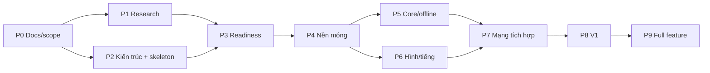

# Kế hoạch tổng viết lại engine Boom KR bằng Rust

Cập nhật: 2026-10-19. **Kế hoạch tổng hiện hành**, thay vai trò điều hành của
[REWRITE_PLAN_2026-10-19 cũ](../archive/plans/REWRITE_PLAN_2026-10-19.md).
Nguồn chuẩn về lộ trình, pha, hạn, dependency và việc tiếp theo.
Scope: [SCOPE_V1](SCOPE_V1.md). Quy tắc: [AGENTS.md](../../AGENTS.md). Repo: `boom-rs` ([ADR 0003](../decisions/0003-engine-repo-and-docs-home.md)).

## Mục tiêu và các quyết định đã có

Viết lại client và server Rust từ client KR còn lại, tái sử dụng tài nguyên đã trích và kiến thức RE.
Không cần tương thích wire protocol/client cũ. Server mới authoritative; legacy VN/emu giữ riêng
làm công cụ tham chiếu. Nền tảng desktop Windows/Linux/macOS; profile Việt hóa dùng font/chữ/ảnh
được duyệt. Server gốc thất lạc: phần không khôi phục được cần DESIGN có nguồn gốc và nghiệm thu.

V1 là lát cắt chơi được; mục tiêu dài hạn vẫn là mở rộng catalog KR. Không lấy V1 thu hẹp để tuyên bố
đã port đủ client gốc. Không dùng 520 opcode VN làm mẫu số tiến độ KR.

| Quyết định | Nguồn |
|---|---|
| Scope V1, policy phòng/vòng đời | [SCOPE_V1](SCOPE_V1.md), [ADR 0001](../decisions/0001-project-baseline.md) |
| VN và KR là nguồn tin cậy ngang nhau | [ADR 0002](../decisions/0002-vn-kr-trusted-sources.md) |
| Repo `boom-rs` chứa engine + docs | [ADR 0003](../decisions/0003-engine-repo-and-docs-home.md) |
| Fixed step, số nguyên, RNG/hash riêng trong core | [ADR 0004](../decisions/0004-time-numeric-model.md) |
| Server quyết kết quả; client chỉ dự đoán di chuyển của mình | [ADR 0005](../decisions/0005-authority-and-prediction.md) |
| Transport mặc định TCP sau trait | [ADR 0006](../decisions/0006-transport-default.md) |
| Client stack chọn bằng spike | [ADR 0007](../decisions/0007-client-stack-spike.md) — Proposed |
| Mở rộng qua Mode/System/Event, overlay luật, dữ liệu item/liveops | [ADR 0008](../decisions/0008-extensibility-model.md) |

### Nguồn chi tiết và trạng thái

| Cần biết | Nguồn chuẩn | Hiện trạng |
|---|---|---|
| V1 làm gì và policy | [SCOPE_V1](SCOPE_V1.md) | Đã chốt; trạng thái G1–G6 xem PROGRESS |
| Chức năng và dependency | [Catalog](../specification/FEATURE_CATALOG.md), [registry](../specification/features.json) | 114 mục: 37 V1, 75 later, 2 drop |
| Tiến độ so với catalog | [PROGRESS](PROGRESS.md), [execution.json](execution.json) | Generated |
| Luật chơi V1: claim và giá trị | [RULES_V1](../specification/gameplay/RULES_V1.md), `data/rules/v1-dev.toml` | Claim có nguồn/trạng thái; profile dev chạy được, chưa đủ phát hành |
| Câu hỏi mở | [QUESTIONS](../research/QUESTIONS.md), [sources](../research/sources/README.md) | Owner/ưu tiên/điều kiện đóng |
| Crate và contracts | [ARCHITECTURE](ARCHITECTURE.md) | `architecture-r1`; walking skeleton đã có trong `crates/` |
| Định danh client/asset | [Evidence](../evidence/README.md) | 13 pack/51.467 entry; 103 tài nguyên V1 fingerprint; closure còn thiếu |
| Giao task và review | [TEAM_WORKFLOW](TEAM_WORKFLOW.md) | Một owner mỗi task, reviewer khác owner |

## Pha hiện tại

Trạng thái pha lấy từ [execution.json](execution.json); trạng thái feature lấy từ
[features.json](../specification/features.json). Khối bên dưới được sinh tự động, không sửa tay.

<!-- PHASE_STATUS:START -->
Pha đang hoạt động: **P0 Tổ chức docs/scope, P1 Tìm thông tin còn thiếu, P2 Cấu trúc dự án/interface**.

| Pha | Trạng thái | Owner | Đầu ra | Gate hoàn thành |
|---|---|---|---|---|
| P0 Tổ chức docs/scope | Chờ review | integrator | Index, rules, registry, scope và migration | Nguồn chuẩn/link/tool rõ, giữ bằng chứng |
| P1 Tìm thông tin còn thiếu | Đang làm | research | Claim có nguồn trong RULES_V1, fixture và QUESTIONS cập nhật | Câu hỏi chặn kiến trúc có trả lời hoặc phương án kiểm chứng rõ |
| P2 Cấu trúc dự án/interface | Đang làm | architecture | ARCHITECTURE r1, ADR 0004–0007, walking skeleton + CI | Boundary/contracts review và giả định quan trọng được ghi nhận |
| P3 Review sẵn sàng | Chưa làm | integrator | Readiness và task prototype | Checklist readiness trong REWRITE_PLAN có kết luận |
| P4 Nền móng/asset/oracle | Chưa làm | assets/RE | Workspace nhỏ, content resolver và oracle fixture | Legacy vẫn chạy, content unknown rõ và schema phù hợp |
| P5 Core/offline | Chưa làm | core | Simulation/replay V1 | Rule scenarios/state hash tái lập và giới hạn nguồn rõ |
| P6 Client hình/tiếng/input | Chưa làm | client | Scene/animation/render/audio/input | Content/presentation contract và acceptance tương ứng |
| P7 Authority/mạng/phòng | Chưa làm | net/backend | Server/client round lifecycle | Authority/convergence, lifecycle và mạng có fixture |
| P8 Tích hợp/QA/phát hành V1 | Chưa làm | integrator/QA | V1 end-to-end trên3OS | Tất cả37feature V1done và6gate releasepassed |
| P9 Mở rộng full feature | Chưa làm | integrator | Các đợt W1–W4 theo registry | Toàn bộ112mục trong baseline hiện hành done; scope mới phải revision riêng |
<!-- PHASE_STATUS:END -->

### Hạn của pha chuẩn bị

P1 và P2 có **hạn 2026-11-02**. Tới hạn, câu hỏi P1 còn mở được xử lý một trong ba cách:
chọn `design` có claim dẫn tới (ghi vào RULES_V1 + profile), chuyển thành thí nghiệm gắn task prototype,
hoặc ghi rõ là không chặn V1. Không gia hạn chỉ vì còn câu hỏi; gia hạn phải ghi lý do ở đây.
P3 (readiness) kết luận ngay sau hạn. Ngày này là đề xuất mặc định, người dùng có thể đổi.

### Dependency và song song

P1 không phải RE xong mọi thứ trước P4: câu hỏi tiếp tục được xử lý ngay trước task phụ thuộc.
P2 gồm walking skeleton (`boom-core`, `boom-content`, `boom-assets`, `boom-replay`, `xtask`) để chứng minh
boundary, nạp profile, replay hash và CI ba OS; skeleton không làm feature nào thành done.
P6 dùng state/animation fixture trước khi P5 hoàn chỉnh. Auth/lobby của P7 chạy song song P5/P6 sau khi
contract chốt; gate P7 cần core và client chạy chung.

Luồng song song theo pha (vai trò, chưa phải người cụ thể):

| Pha | Luồng chạy cùng lúc | Owner / reviewer |
|---|---|---|
| P1–P2 | START-A content closure; START-B luật/hiệu chuẩn; START-C contracts; skeleton | assets/RE, RE/core, core+net, integrator / QA |
| P4 | Asset pipeline Rust (pack → bundle); oracle fixture; profile dev đầy đủ | assets/RE / QA |
| P5 | Movement/collision; bom/lửa/chain; item; trapped/kết quả; replay | core / QA |
| P6 | Spike client stack (ADR 0007) → scene, animation, audio, input, Việt hóa | client / QA |
| P7 | Auth/session; phòng; authority + prediction; fixture mạng | net/backend + core / QA |
| P8 | Tích hợp end-to-end, build ba OS, báo cáo sai khác | integrator / QA |

## Nguyên tắc fidelity và đo nguồn

Mục tiêu giữ cảm giác và tài nguyên nguyên bản ở phần có nguồn xác nhận. Mỗi luật thuộc một trong:
**confirmed** (KR hoặc VN, ADR 0002), **candidate** (web, OSS, giá trị emu tự đặt), **design** (dự án chọn,
có claim dẫn tới) hoặc **unknown**. Profile drop Village00 V1 và Việt hóa là khác biệt có chủ ý, theo SCOPE_V1.

Trước khi dùng trace làm oracle, đo độ lặp của chính client nguồn; lưu build/patch/config emu,
trạng thái đầu, input thực nhận, clock/seed khi lấy được và giới hạn của debugger. Log emu hẹn fuse
không đo được fuse server gốc. Script xdotool/sleep chưa bảo đảm input cùng tick.

Nghiệm thu riêng: state/event theo rule và sai số đã đặc tả; pixel RGBA/ROI cho sprite/scene;
timing/side effect audio; input latency/focus; hội tụ và correction trong fixture mạng;
playtest tình huống chuẩn. `snapdiff.py` so snapshot bộ nhớ VM, không phải image diff.
Ngưỡng chính xác gắn fixture/nguồn hoặc quyết định DESIGN; không chép ngưỡng 0 px/99,5% của plan cũ.

## Server thiếu nguồn: khôi phục hoặc thiết kế lại

Theo từng hành vi: dữ liệu/code client → đo runtime → guide/patch/video có build-region → DESIGN.
Legacy là mô hình lai: server quyết fuse, item ẩn và xác nhận nhặt; client quyết di chuyển, vỡ gạch,
nhốt và chết ([ADR 0005](../decisions/0005-authority-and-prediction.md)). Server mới quyết tất cả;
phần client gốc tự quyết là nơi cần đo feel kỹ nhất.

V1 chỉ cần identity, session, room/match, validation và trạng thái trận theo scope.
Economy/ledger/inventory/guild/liveops giữ trong backlog sau V1. Không chép server giả lập thành backend.
Khi mở economy phải có transaction/idempotency, ownership và nguồn balance (Q-011).

## Việc tiếp theo

| Ưu tiên | Việc | Owner / reviewer | Đầu ra |
|---|---|---|---|
| 1 | START-A: đọc bảng thuộc tính tile/obj của theme Village (KR, đối chiếu VN qua độ lệch R-004) → phân loại ô Village00 | assets/RE / core | RULES_V1 R-006/R-007 thành confirmed; bảng phân loại trong `data/` |
| 1 | START-B: hiệu chuẩn tick và speed-level → px/s trên client VN; tìm hằng số timer nhốt trong code | RE / core | RULES_V1 R-013, R-026, R-043; cập nhật profile |
| 1 | START-C: contracts-r1 (InputCommand/State/Event/Snapshot/Replay) dựa trên skeleton | core+net / QA | ARCHITECTURE §5 + kiểu Rust trong `boom-core` |
| 1 | Review độc lập repo move, AGENTS mới và ADR 0003–0006 | reviewer / integrator | execution.json P0/P2 |
| 2 | Tìm consumer bảng rơi R-051/R-052 và xác suất gạch có item | RE / core | RULES_V1 §5 |
| 2 | Chốt UI/content/Việt hóa V1 (Q-012) | client/l10n / QA | Spec localization |
| 3 | Kết luận P3 readiness, lập task P4/P5 có feature ID | integrator / reviewer | execution.json + features.json |

Mỗi task thực tế ghi người nhận, baseline, file được sửa, dependency, đầu ra và cách kiểm theo TEAM_WORKFLOW.

## Readiness trước khi mở task feature

- [ ] Scope V1 và registry không mâu thuẫn, không dependency vào mục later.
- [ ] Content identity được khóa; phần asset chưa resolve và fixture cần thêm được liệt kê.
- [x] Mô hình thời gian/số học đã chọn ([ADR 0004](../decisions/0004-time-numeric-model.md)); hiệu chuẩn còn mở.
- [ ] Crate boundaries và contracts-r1 được review (skeleton đã có, chưa review).
- [x] Chiến lược authority/prediction có quyết định mặc định ([ADR 0005](../decisions/0005-authority-and-prediction.md)).
- [x] Transport có mặc định và điều kiện đảo ([ADR 0006](../decisions/0006-transport-default.md)); persistence còn ở Q-011 (không chặn P5).
- [ ] Legacy oracle chạy theo đường dẫn/command đã kiểm từ `boom-re` main.
- [ ] Task P4/P5 đầu tiên có feature ID, owner, reviewer, acceptance.

Các gate G1–G6 trong SCOPE_V1 áp dụng dần khi triển khai/phát hành; không cần tất cả xanh để mở P4.

## Sau V1: mở rộng catalog theo đợt

Định hướng P9; mỗi đợt chốt feature IDs và revision scope riêng từ registry.

| Đợt | Nội dung dự kiến | Dependency/gate |
|---|---|---|
| W1 Battle mở rộng và xã hội | Đội/rescue, thêm người/map/item; bạn bè, whisper, tương tác phòng | V1 ổn; mode/roster contract; không đổi replay V1 |
| W2 Tiến trình và kinh tế | Inventory/equip/cosmetic, shop/trade, level/EXP, wallet | Auth/storage ổn, transaction/ledger/idempotency; chưa cash thật |
| W3 Mode và nội dung | HiddenCatch, AI/Baseball/Monster/RPG và ứng viên mode khác | Mode có thật/đúng build, asset/script/AI closure; spec + oracle hoặc DESIGN |
| W4 Hệ thống dài hạn | Guild, quest/pass, event/season/reward/gacha, admin/moderation | Quyền, lịch/reset, delivery idempotent, economy |

Magic Market phụ thuộc cả economy và content/UI; SandBox/Partners/DIYBomb giữ mức candidate tới khi rõ hành vi.
Cash/thanh toán thật là workstream riêng ngoài baseline này.

### Playbook cho mỗi feature

1. Nhận ID trong catalog và câu hỏi/claim liên quan; ghi revision và scope.
2. Truy UI/asset/chuỗi/code/consumer; khi chạy được, mở luồng trên client nguồn để đối chiếu.
3. Viết spec hành vi, state, dữ liệu server và acceptance; tách quyết định sản phẩm khỏi mức bằng chứng.
4. Thiết kế command/backend/UI/core theo contract đã chốt; giá trị luật vào profile kèm claim.
5. Triển khai nhỏ; reviewer kiểm nguồn và logic độc lập; chạy fixture/integration.
6. Cập nhật registry và bàn giao demo/giới hạn. Không sinh plan riêng cho feature.

## Rủi ro

| Rủi ro | Cách quản lý |
|---|---|
| Khác biệt cụ thể VN/KR (offset, ID, map, mode) | Profile theo build; ví dụ R-003/R-004; web/OSS khác build vẫn là candidate |
| Phép đo bị timing/emu/debugger làm sai | Q-004/Q-009: đo độ lặp, tách event client/emu |
| Map/frame/script chưa hiểu đủ dù decode được | Q-002/Q-003: closure và consumer trước task phụ thuộc |
| Luật server mất nguồn | RULES_V1: candidate → design có review; không giấu default |
| Feel đổi do chuyển quyền quyết định sang server | ADR 0005; fixture lag + playtest sớm trong P5/P7 |
| Chuyển repo làm agent đọc docs cũ | ADR 0003; stub/banner ở repo cũ; router `/home/admin/AGENTS.md` |
| Research kéo dài vô hạn | Hạn P1/P2; câu hỏi còn mở phải có quyết định tạm |
| Docs phình | Một nguồn chuẩn; phát hiện mới vào backlog, không tự thêm V1 |

Chưa chốt số người hoặc lịch sau P3; ước lượng lại từ throughput thật của P4/P5.
Không dùng lại cam kết 6–8 tháng/1,5–2 năm của plan lịch sử.

## Đối chiếu kế hoạch cũ

| Phần trong REWRITE_PLAN_2026-10-19 | Nguồn hiện hành |
|---|---|
| §0–1 Bối cảnh/khả thi | Mục tiêu ở đây; SCOPE_V1 |
| §2 Fidelity | Mục fidelity ở đây, RULES_V1, gate G1–G6 |
| §3 Biết/chưa biết | RULES_V1 + QUESTIONS + evidence |
| §4 Oracle | P1/P4, Q-004/Q-009, replay contract |
| §5 Kiến trúc | ARCHITECTURE + ADR 0004–0007 |
| §6 R0–R7 | P0–P9 ở đây |
| §7 Rủi ro | Bảng rủi ro ở đây và QUESTIONS |
| §8 Việc làm ngay | Việc tiếp theo ở đây |
| §9 Full feature/backend | P9/W1–W4 ở đây; registry là nguồn feature IDs |
| §10 KR profile | SCOPE_V1 + RULES_V1 + ADR 0002 |

Audit lịch sử: [REWRITE_PLAN_AUDIT](../archive/reports/REWRITE_PLAN_AUDIT_2026-10-19.md).
Nhóm mốc M0–M5 của TEAM_WORKFLOW cũ đã gộp vào P0–P9 ở trên.

## Baseline và repo

- Target KR `00967`, scope `KR-00967-V1-scope-1`.
- Repo tích hợp: `/home/admin/boom-rs`, nhánh `main`. Docs import từ
  `boom-re-l10n@9bde2ce` ([DOCS_MIGRATION](../evidence/DOCS_MIGRATION.json)).
- Legacy oracle: `/home/admin/boom-re` main (`4ccc890` khi import) — server giả lập VN, RE notebook, tool đo.
- `/home/admin/boom-re-l10n`: Việt hóa và tool đọc pack (`kr_feature_inventory.py`, `kr_v1_content.py`).
- `/home/admin/boomkr-re`: nghiên cứu/binary/metadata KR.

## Khi kết thúc một phiên

Cập nhật nguồn chuẩn (registry, execution.json, QUESTIONS, RULES_V1, ADR); chạy
`python3 tools/kr_catalog.py` rồi `--check`, và `cargo xtask ci` nếu có đổi code.
Không tạo plan mới; chỉ reviewer nghiệm thu mới cho done.
