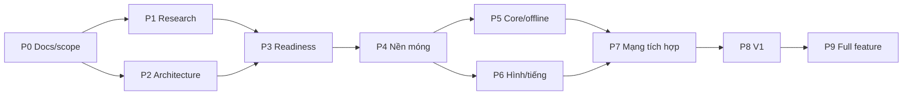

# Kế hoạch tổng viết lại engine Boom KR bằng Rust

Cập nhật: 2026-10-19. **Đây là kế hoạch tổng hiện hành**, thay thế vai trò điều hành của
[REWRITE_PLAN_2026-10-19 cũ](../archive/plans/REWRITE_PLAN_2026-10-19.md).
File này được mở rộng từ ROADMAP trước đây, không tạo thêm một kế hoạch song song.
Nguồn chuẩn về lộ trình toàn dự án, pha, dependency và công việc tiếp theo.
Scope: [SCOPE_V1](SCOPE_V1.md). Quy tắc: [AGENTS.md](../../AGENTS.md).

## Mục tiêu và các quyết định đã có

Viết lại client và server Rust từ client KR còn lại, tái sử dụng tài nguyên đã trích và kiến thức RE.
Không cần tương thích wire protocol/client cũ. Server mới authoritative; legacy VN/emu giữ riêng
làm công cụ tham chiếu. Nền tảng desktop Windows/Linux/macOS; profile Việt hóa dùng font/chữ/ảnh
được duyệt. Server gốc thất lạc: phần không khôi phục được cần DESIGN có nguồn gốc và nghiệm thu.

V1 là lát cắt chơi được; mục tiêu dài hạn vẫn là mở rộng catalog KR. Không lấy V1 thu hẹp để tuyên bố
đã port đủ client gốc. Không dùng 520 opcode VN làm mẫu số tiến độ KR.

### Nguồn chi tiết và trạng thái

| Cần biết | Nguồn chuẩn | Hiện trạng |
|---|---|---|
| V1 làm gì và policy | [SCOPE_V1](SCOPE_V1.md) | Spec định nghĩa scope/policy; trạng thái G1–G6 xem PROGRESS |
| Chức năng và dependency | [Catalog](../specification/FEATURE_CATALOG.md), [registry](../specification/features.json) | 114 mục:37V1,75later,2drop; trạng thái/proof theo PROGRESS |
| Tiến độ thực tế so với catalog | [PROGRESS](PROGRESS.md), [execution.json](execution.json) | Báo cáo generated: done/tổng V1 và catalog, trạng thái từng mục, phase và release gates |
| Biết/chưa biết, nguồn luật | [QUESTIONS](../research/QUESTIONS.md), [sources](../research/sources/README.md) | Câu hỏi có ưu tiên/owner/status; web khác region/build không tự xác nhận KR |
| Crate/module và contracts | [ARCHITECTURE](ARCHITECTURE.md) | Revision và trạng thái quyết định nằm trong architecture/ADR; không suy từ % feature |
| Định danh client/asset | [Evidence](../evidence/README.md) | 13 pack/51.467 entry; 103 tài nguyên V1 fingerprint; dependency closure còn thiếu |
| Giao task và review | [TEAM_WORKFLOW](TEAM_WORKFLOW.md), [AGENTS](../../AGENTS.md) | Một owner mỗi task, contract revision và reviewer; không sinh plan riêng theo agent |

Không sao chép toàn bộ scope, schema hoặc backlog vào file này; agent đi theo các link trên để lấy
chi tiết hiện hành. Bản kế hoạch tổng giữ thứ tự, dependency, gate và mục tiêu dài hạn.

## Pha hiện tại

Trạng thái pha lấy từ [execution.json](execution.json); trạng thái từng feature lấy từ
[features.json](../specification/features.json). Xem [PROGRESS](PROGRESS.md) để biết done/chưa done
và tỷ lệ nghiệm thu so với FEATURE_CATALOG. Khối bên dưới được sinh tự động, không sửa tay.

<!-- PHASE_STATUS:START -->
Pha đang hoạt động: **P1 Tìm thông tin còn thiếu, P2 Cấu trúc dự án/interface**.

| Pha | Trạng thái | Owner | Đầu ra | Gate hoàn thành |
|---|---|---|---|---|
| P0 Tổ chức docs/scope | Đã nghiệm thu | integrator | Index, rules, registry, scope và migration | Nguồn chuẩn/link/tool rõ, giữ bằng chứng |
| P1 Tìm thông tin còn thiếu | Đang làm | research | Claim/source/fixture và backlog câu hỏi | Câu hỏi chặn kiến trúc có trả lời hoặc phương án kiểm chứng rõ |
| P2 Cấu trúc dự án/interface | Đang làm | architecture | Architecture và contract draft/ADR | Boundary/contracts review và giả định quan trọng được ghi nhận |
| P3 Review sẵn sàng | Chưa làm | integrator | Readiness và task prototype | Checklist readiness trong REWRITE_PLAN có kết luận |
| P4 Nền móng/asset/oracle | Chưa làm | assets/RE | Workspace nhỏ, content resolver và oracle fixture | Legacy vẫn chạy, content unknown rõ và schema phù hợp |
| P5 Core/offline | Chưa làm | core | Simulation/replay V1 | Rule scenarios/state hash tái lập và giới hạn nguồn rõ |
| P6 Client hình/tiếng/input | Chưa làm | client | Scene/animation/render/audio/input | Content/presentation contract và acceptance tương ứng |
| P7 Authority/mạng/phòng | Chưa làm | net/backend | Server/client round lifecycle | Authority/convergence, lifecycle và mạng có fixture |
| P8 Tích hợp/QA/phát hành V1 | Chưa làm | integrator/QA | V1 end-to-end trên3OS | Tất cả37feature V1done và6gate releasepassed |
| P9 Mở rộng full feature | Chưa làm | integrator | Các đợt W1–W4 theo registry | Toàn bộ112mục trong baseline hiện hành done; scope mới phải revision riêng |
<!-- PHASE_STATUS:END -->

Đây là trình tự và điều kiện, chưa phải cam kết thời gian. Các ước lượng cũ trong archive không còn là lịch V1.

### Dependency và song song khi đã mở triển khai

P1 không kết thúc toàn bộ RE trước P4: các câu hỏi tiếp tục được xử lý ngay trước task phụ thuộc.
P6 dùng state/animation fixture trước khi P5 hoàn chỉnh. Thiết kế và phần auth/lobby P7 có thể chạy
song song P5/P6 sau khi contract đã chốt; gate P7 tích hợp vẫn cần core và client chạy chung.
Owner/reviewer theo luồng: assets/RE cho P4, core/QA cho P5, client/QA cho P6,
net/backend + core/QA cho P7, integrator/QA cho P8. Đây chưa phải phân công người cụ thể.

## Nguyên tắc fidelity và đo nguồn

Mục tiêu giữ cảm giác và tài nguyên nguyên bản ở phần có nguồn xác nhận. Tách ba kết quả:
**verified KR**, **đối chiếu VN/nguồn khác build** và **DESIGN V1**; không cam kết ~100% KR
chỉ vì replay giống VN. Profile drop Village00 V1 và Việt hóa là khác biệt có chủ ý, theo SCOPE_V1.

Trước khi dùng trace làm oracle, đo độ lặp của chính client nguồn; lưu build/patch/config emu,
initial state, input thực nhận, clock/seed khi lấy được và giới hạn của debugger. Log emu hẹn fuse
không đo được fuse server gốc. Script xdotool/sleep chưa tự bảo đảm input cùng tick.

Nghiệm thu riêng: state/event theo rule và sai số đã đặc tả; pixel RGBA/ROI cho sprite/scene;
timing/side effects audio; input latency/focus; state hội tụ và correction trong fixture mạng;
playtest tình huống chuẩn. Không dùng `snapdiff.py` làm image diff: nó so snapshot bộ nhớ VM.
Test do implementation sinh chỉ là regression baseline, không là bằng chứng fidelity độc lập.
Các con số ngưỡng chính xác phải gắn fixture/nguồn hoặc quyết định DESIGN; không sao chép
ngưỡng 0 px/99,5% của plan cũ sang mọi profile khi chưa kiểm điều kiện đo.

Tham chiếu phương pháp/fixture và rule còn thiếu: Q-004–009 trong QUESTIONS;
schema/runtime boundaries nằm trong ARCHITECTURE. Quyết timing/số học và thư viện qua ADR/thí nghiệm,
không khóa fixed tick/không float hoặc renderer chỉ vì kế hoạch cũ đã ghi.

## Server thiếu nguồn: cách khôi phục hoặc thiết kế lại

Theo từng hành vi: dữ liệu/code client đúng build → đo runtime nguồn → guide/patch/video có
build-region → DESIGN phần còn thiếu. Không mặc định mọi công thức/rate đều ở server hoặc đều ở pack.
Phân biệt client tự quyết với quyết định emu đã cung cấp; khi có server mới, authority thuộc server.

V1 chỉ cần identity, session, room/match, validation và trạng thái trận theo scope.
Economy/ledger/inventory/guild/liveops giữ trong backlog sau V1. Không khôi phục wire protocol cũ
hoặc chép server giả lập thành backend production để đạt chỉ tiêu tiến độ.
Khi mở economy, phải có transaction/idempotency, ownership và nguồn balance; lựa chọn DB/transport
không được coi là đã chốt bởi tài liệu lịch sử. Xem ARCHITECTURE và Q-010/011/013.

## Việc tiếp theo và owner theo luồng

| Ưu tiên | Việc | Owner / reviewer | Đầu ra cập nhật vào |
|---|---|---|---|
| 1 | Phân loại source đúng build/region; xử lý kết luận web và emu đang lẫn nhau | research / RE | QUESTIONS + source register + findings |
| 1 | Map Village00→tile/object/collision; bốn spawn có dùng được không | assets/RE / core | QUESTIONS và spec assets; fixture/metadata vào evidence |
| 1 | C00/C01→Attr; time model, speed, hitbox, fuse/chain/trap còn thiếu | RE / core | QUESTIONS; spec rule khi đã có nguồn, chưa hardcode giả |
| 1 | Chốt boundary core/assets/render/net/backend và hợp đồng input/state/event | architecture / net+QA | ARCHITECTURE + ADR |
| 2 | Quyết transport, persistence tối thiểu, strategy prediction/reconciliation | net/backend / integrator | ADR với phương án và gate kiểm chứng |
| 2 | Chốt UI/content/Việt hóa V1 và đường dẫn nguồn chuẩn | client/l10n / QA | QUESTIONS + spec localization |
| 3 | Lập task prototype và chọn baseline commit để tích hợp main/worktree | integrator / reviewer | P3 readiness + task trong workflow |

Owner là vai trò, chưa phải người/agent được gán cố định. Mỗi task thực tế phải ghi người nhận,
baseline/worktree, file được sửa, dependency, đầu ra và cách kiểm theo TEAM_WORKFLOW.

## Readiness trước khi mở triển khai

- [ ] Scope V1 và registry không mâu thuẫn, không dependency vào mục later.
- [ ] Client/pack/content identity được khóa; biết rõ phần asset chưa resolve và fixture nguồn cần thêm.
- [ ] Timing/số học/collision có hướng kiểm chứng; unknown không bị gắn nhãn verified KR.
- [ ] Workspace/crate boundaries và contracts revision đầu đã được review.
- [ ] Net authority/command/snapshot/replay và event side effects được mô tả đủ để chia task độc lập.
- [ ] Quyết định transport/persistence có phương án, lý do và thí nghiệm cần làm; chưa cần backend production.
- [ ] Baseline tích hợp đã chọn, legacy oracle vẫn chạy theo đường dẫn/command đã kiểm.
- [ ] Có task prototype nhỏ, acceptance, owner và reviewer; cập nhật pha trước khi bắt đầu.

Các gate sản phẩm G1–G6 trong SCOPE_V1 áp dụng dần khi triển khai/phát hành; không cần tất cả xanh
mới bắt đầu prototype. Readiness yêu cầu kiểm soát giả định và biết phần nào prototype sẽ giải quyết.
Yêu cầu mới của người dùng có thể mở rộng task/pha; không yêu cầu xác nhận lại các quyền đã có.

## Sau V1: mở rộng catalog theo đợt

Đây là định hướng P9, không phải lệnh mở 75 mục later ngay trong pha planning.
Mỗi đợt chốt feature IDs và revision scope riêng từ registry, nghiên cứu đủ phần phụ thuộc rồi mới giao code.

| Đợt | Nội dung dự kiến | Dependency/gate |
|---|---|---|
| W1 Battle mở rộng và xã hội | Đội/rescue, thêm người/map/item đã xác minh; bạn bè, whisper và tương tác phòng ngoài V1 | V1 ổn; mode/roster/permission contract và rule mới có nguồn; không vô tình đổi replay V1 |
| W2 Tiến trình và kinh tế | Inventory/equip/cosmetic, shop/trade, level/EXP, ownership và wallet | Auth/storage ổn, transaction/ledger/idempotency và balance có provenance; chưa cash thật |
| W3 Mode và nội dung | Các nhóm HiddenCatch, AI/Baseball/Monster/RPG và các ứng viên mode khác trong catalog | Xác định mode có thật/đúng build, asset/script/AI closure; spec và oracle hoặc DESIGN cho từng mode |
| W4 Hệ thống dài hạn | Guild, quest/pass, event/season/reward/gacha, admin/moderation và nội dung tùy biến | Quyền, lịch/reset, delivery idempotent, economy và dữ liệu vận hành theo feature; không tự coi asset name là chức năng đầy đủ |

W2 và W3 có thể song song khi interface và ownership đã ổn, nhưng không dùng song song để bỏ dependency.
Một số tính năng như Magic Market phụ thuộc cả economy và content/UI; integrator xếp theo dependency,
không chỉ theo tên đợt. Các nhóm còn mơ hồ như SandBox/Partners/DIYBomb giữ mức candidate cho tới khi
xác định luồng/hành vi. Cash/thanh toán thật là workstream riêng ngoài baseline này.

### Playbook cho mỗi feature

1. Nhận ID trong catalog và câu hỏi/nguồn liên quan; ghi revision và scope.
2. Truy UI/asset/chuỗi/code/consumer; khi chạy được thì mở màn/luồng trên client nguồn để đối chiếu.
3. Viết spec hành vi, state, dữ liệu server và acceptance; đánh dấu PORT/REDESIGN/DROP nếu cần,
   tách quyết định sản phẩm khỏi mức bằng chứng và release scope.
4. Thiết kế command/backend/UI/core adapters theo contract đã chốt; resolve dữ liệu và unknown.
5. Triển khai thay đổi nhỏ; reviewer kiểm nguồn và logic độc lập; chạy fixture/integration phù hợp.
6. Cập nhật implementation status trong registry và bàn giao demo/giới hạn. Không sinh plan riêng cho feature.

Chỉ gọi một release/full-feature milestone xong khi toàn bộ mục của catalog revision đã chọn có disposition,
mọi mục cần triển khai đã qua acceptance và mọi sai khác có chủ ý được ghi nhận.
Điều đó không chứng minh đã tìm ra mọi nhánh ẩn của executable. Đếm opcode VN, số asset hoặc số agent
không thay thế tiến độ feature chơi được, rule có nguồn và unknown đã xử lý.

## Rủi ro, lịch và đo tiến độ

| Rủi ro chính | Cách quản lý/nguồn tiếp theo |
|---|---|
| VN khác KR, archive khác build/event | Claim matrix Q-001; giữ provenance/profile riêng, không nâng confidence bằng suy đoán |
| Phép đo bị timing/emu/debugger làm sai | Q-004/Q-009: repeatability và fixture identity, tách client/emu events |
| Map/frame/script chưa hiểu đủ dù ảnh decode được | Q-002/Q-003; dependency closure và consumer semantics trước task phụ thuộc |
| Luật server và cân bằng mất nguồn | Q-006/Q-007/Q-011; RE/source hoặc DESIGN có revision, không giấu default |
| Net authority làm lệch feel hoặc lặp side effects | Q-008/Q-010; replay/snapshot completeness, convergence và presentation journal |
| Chuyển workspace làm hỏng oracle hoặc chép nhầm snapshot cũ | Q-013; baseline/migration/test command rõ trước đổi layout |
| Scope và docs tiếp tục phình | Registry scope, nguồn chuẩn và rule AGENTS; phát hiện mới vào backlog, không tự thêm V1 |

Chưa chốt số người thực tế hoặc lịch. Vai trò và cách chạy song song ở TEAM_WORKFLOW;
ước lượng lại sau khi có phép đo lặp và prototype nhỏ. Lập critical path theo task, nguồn dữ liệu,
người phụ trách và throughput thật. Không dùng lại cam kết 6–8 tháng/1,5–2 năm của plan lịch sử.

## Đối chiếu nội dung kế hoạch cũ

Bảng này để agent từ file archive biết phải tới đâu; không dùng archive làm lệnh triển khai.

| Phần trong REWRITE_PLAN_2026-10-19 | Nguồn hiện hành/thay đổi sau audit |
|---|---|
| §0–1 Bối cảnh/khả thi | Mục tiêu, trạng thái và nguồn của file này; SCOPE_V1 chốt quyết định sản phẩm |
| §2 Fidelity | Mục fidelity/đo nguồn ở đây, Q-004–009 và acceptance G1–G6; bỏ cam kết KR100% chưa đủ nguồn |
| §3 Biết/chưa biết | QUESTIONS + evidence + spec tham chiếu; không chép bảng VN thành bảng KR |
| §4 Oracle | P1/P4, Q-004/Q-009 và contract replay; chưa có golden độc lập chỉ vì emu chạy đúng |
| §5 Kiến trúc | ARCHITECTURE + ADR; layout7package là draft, không chốt mọi lựa chọn cũ |
| §6 R0–R7 | P0–P8 ở đây; tách planning/readiness khỏi implementation và cập nhật scope37mục |
| §7 Rủi ro | Bảng rủi ro ở đây và QUESTIONS có owner/method/done criterion |
| §8 Việc làm ngay | Bảng ưu tiên/owner ở đây, QUESTIONS và task template trong TEAM_WORKFLOW |
| §9 Full feature/backend | P9/W1–W4 và playbook ở đây; registry là nguồn feature IDs, không dùng 520 opcode VN |
| §10 KR profile | SCOPE_V1 + evidence + ARCHITECTURE: rules/content identity, VN/KR là trusted source ngang nhau |

Audit lịch sử vẫn ở [REWRITE_PLAN_AUDIT](../archive/reports/REWRITE_PLAN_AUDIT_2026-10-19.md).
Việc điều chỉnh kế hoạch sau audit không đồng nghĩa đã giải xong các unknown kỹ thuật hoặc triển khai feature.

## Baseline và worktree

- Mục tiêu: KR `00967`, scope `KR-00967-V1-scope-1`.
- Docs/catalog đang làm ở `/home/admin/boom-re-l10n`, nhánh `claude/l10n-kr-vi`;
  nền trước các thay đổi planning là `231ac01`; xem `git log -1`/`git status` để biết revision hiện hành.
- Main `/home/admin/boom-re` tại `4ccc890` có server tham chiếu mới hơn snapshot l10n.
  Không tạo workspace từ bản server cũ trong worktree chỉ vì docs hiện nằm ở đó.
- `/home/admin/boomkr-re` giữ nghiên cứu/binary/metadata KR; không sao chép engine code sang repo này.
- Bản đồ đổi đường dẫn ở [DOCS_MIGRATION](../evidence/DOCS_MIGRATION.json). Không coi đường dẫn mới
  trong docs là đã tồn tại ở main cho tới khi tích hợp; dùng worktree hiện hành để chạy lệnh docs.

## Khi kết thúc một phiên

Cập nhật trạng thái đúng ở đây hoặc QUESTIONS/ADR tương ứng, giữ việc tiếp theo rõ ràng.
Không tạo một plan mới, không chuyển implementation thành done vì đã viết docs, không lấy số agent
hoặc số opcode làm phần trăm hoàn thành engine.
Task feature cập nhật `implementation` và `tracking` trong registry; task planning/research cập nhật
phase/gates ở execution.json cùng QUESTIONS. Chạy `python3 tools/kr_catalog.py` rồi `--check` để sinh
PROGRESS, CSV và phase table của plan. Chỉ reviewer nghiệm thu mới cho done; chưa qua gate thì chưa release.

Chính sách nguồn hiện hành: [VN/KR trusted ngang nhau](../decisions/0002-vn-kr-trusted-sources.md). Dùng trực tiếp bằng chứng VN cho luật chung; giữ provenance và xử lý khác biệt cụ thể.
