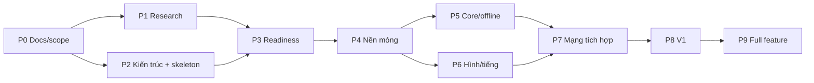

# Kế hoạch tổng viết lại engine Boom KR bằng Rust

Cập nhật: 2026-10-23 (rà bằng chứng gate V1 G1–G6, việc còn thiếu và sổ pha/gate stale).
**Kế hoạch tổng hiện hành**, thay vai trò điều hành của
[REWRITE_PLAN_2026-10-19 cũ](../archive/plans/REWRITE_PLAN_2026-10-19.md).
Cập nhật: 2026-10-22 (hàng đợi RE theo consumer và giới hạn nguồn).
Cập nhật: 2026-10-20 (§Nguyên tắc fidelity: % feature done và số claim `confirmed` không phải
% fidelity; trỏ [SCOPE_V1 §10](SCOPE_V1.md#10-sai-khác-có-chủ-ý-so-với-client-gốc) và Q-009).
Trước đó: 2026-10-19.
Nguồn chuẩn về lộ trình, pha, hạn, dependency và việc tiếp theo.
Scope: [SCOPE_V1](SCOPE_V1.md). Quy tắc: [AGENTS.md](../../AGENTS.md). Repo: `boom-rs` ([ADR 0003](../decisions/0003-engine-repo-and-docs-home.md)).

## Mục tiêu và các quyết định đã có

Viết lại client và server Rust từ client KR còn lại, tái sử dụng tài nguyên đã trích và kiến thức RE.
Không cần tương thích wire protocol/client cũ. Server mới authoritative; legacy VN/emu giữ riêng
làm công cụ tham chiếu. Nền tảng desktop Windows/Linux/macOS; profile Việt hóa dùng font/chữ/ảnh
được duyệt. Server gốc thất lạc: phần không khôi phục được cần DESIGN có nguồn gốc và nghiệm thu.

V1 là lát cắt chơi được; mục tiêu dài hạn vẫn là mở rộng catalog KR. Không lấy V1 thu hẹp để tuyên bố
đã port đủ client gốc. Không dùng 520 opcode VN làm mẫu số tiến độ KR.

| Quyết định | Nguồn |
|---|---|
| Scope V1, policy phòng/vòng đời | [SCOPE_V1](SCOPE_V1.md), [ADR 0001](../decisions/0001-project-baseline.md) |
| VN dùng trực tiếp; giá trị ưu tiên KR confirmed → VN confirmed → BnB → design | [ADR 0002](../decisions/0002-vn-kr-trusted-sources.md), [ADR 0013](../decisions/0013-rule-source-precedence.md) |
| Repo `boom-rs` chứa engine + docs | [ADR 0003](../decisions/0003-engine-repo-and-docs-home.md) |
| Fixed step, số nguyên, RNG/hash riêng trong core | [ADR 0004](../decisions/0004-time-numeric-model.md) |
| Server quyết kết quả; client chỉ dự đoán di chuyển của mình | [ADR 0005](../decisions/0005-authority-and-prediction.md) |
| Transport mặc định TCP sau trait | [ADR 0006](../decisions/0006-transport-default.md) |
| Client stack: macroquad (có điều kiện) | [ADR 0010](../decisions/0010-client-stack-choice.md) (thay 0007) |
| Giao thức InputCommand/Snapshot, codec | [ADR 0009](../decisions/0009-wire-protocol-input-snapshot-codec.md) |
| Mở rộng qua Mode/System/Event, overlay luật, dữ liệu item/liveops | [ADR 0008](../decisions/0008-extensibility-model.md) |

### Nguồn chi tiết và trạng thái

| Cần biết | Nguồn chuẩn | Hiện trạng |
|---|---|---|
| V1 làm gì và policy | [SCOPE_V1](SCOPE_V1.md) | Đã chốt; trạng thái G1–G6 xem PROGRESS |
| Chức năng và dependency | [Catalog](../specification/FEATURE_CATALOG.md), [registry](../specification/features.json) | 114 mục: 37 V1, 75 later, 2 drop |
| Tiến độ so với catalog | [PROGRESS](PROGRESS.md), [execution.json](execution.json) | Generated |
| Luật chơi V1: claim và giá trị | [RULES_V1](../specification/gameplay/RULES_V1.md), `data/rules/v1-dev.toml` | Claim có nguồn/trạng thái; profile dev chạy được, chưa đủ phát hành |
| Câu hỏi mở | [QUESTIONS](../research/QUESTIONS.md), [sources](../research/sources/README.md) | Owner/ưu tiên/điều kiện đóng |
| Crate và contracts | [ARCHITECTURE](ARCHITECTURE.md) | `architecture-r1`; walking skeleton đã có trong `crates/` |
| Định danh client/asset | [Evidence](../evidence/README.md) | 13 pack/51.467 entry; 103 tài nguyên V1 fingerprint; closure còn thiếu |
| Giao task và review | [TEAM_WORKFLOW](TEAM_WORKFLOW.md) | Một owner mỗi task, reviewer khác owner |

## Pha hiện tại

Trạng thái pha lấy từ [execution.json](execution.json); trạng thái feature lấy từ
[features.json](../specification/features.json). Khối bên dưới được sinh tự động, không sửa tay.

<!-- PHASE_STATUS:START -->
Pha đang hoạt động: **P1 Tìm thông tin còn thiếu, P2 Cấu trúc dự án/interface**.

| Pha | Trạng thái | Owner | Đầu ra | Gate hoàn thành |
|---|---|---|---|---|
| P0 Tổ chức docs/scope | Đã nghiệm thu | integrator | Index, rules, registry, scope và migration | Nguồn chuẩn/link/tool rõ, giữ bằng chứng |
| P1 Tìm thông tin còn thiếu | Đang làm | research | Claim có nguồn trong RULES_V1, fixture và QUESTIONS cập nhật | Câu hỏi chặn kiến trúc có trả lời hoặc phương án kiểm chứng rõ |
| P2 Cấu trúc dự án/interface | Đang làm | architecture | ARCHITECTURE r1, ADR 0004–0008, contracts-r3 trong code, harness scenario, CI ba OS | Boundary/contracts review và giả định quan trọng được ghi nhận |
| P3 Review sẵn sàng | Chưa làm | integrator | Readiness và task prototype | Checklist readiness trong REWRITE_PLAN có kết luận |
| P4 Nền móng/asset/oracle | Chưa làm | assets/RE | Workspace nhỏ, content resolver và oracle fixture | Legacy vẫn chạy, content unknown rõ và schema phù hợp |
| P5 Core/offline | Chưa làm | core | Simulation/replay V1 | Rule scenarios/state hash tái lập và giới hạn nguồn rõ |
| P6 Client hình/tiếng/input | Chưa làm | client | Scene/animation/render/audio/input | Content/presentation contract và acceptance tương ứng |
| P7 Authority/mạng/phòng | Chưa làm | net/backend | Server/client round lifecycle | Authority/convergence, lifecycle và mạng có fixture |
| P8 Tích hợp/QA/phát hành V1 | Chưa làm | integrator/QA | V1 end-to-end trên3OS | Tất cả37feature V1done và6gate releasepassed |
| P9 Mở rộng full feature | Chưa làm | integrator | Các đợt W1–W4 theo registry | Toàn bộ112mục trong baseline hiện hành done; scope mới phải revision riêng |
<!-- PHASE_STATUS:END -->

### Sổ pha/gate đang lệch so với code đã tích hợp (2026-10-23)

Khối trên là snapshot generated từ [execution.json](execution.json), `updated_at` **2026-10-19**; nó
không phản ánh code đã merge tới `main` ngày 2026-10-23. Cụ thể, sổ vẫn ghi P1/P2 "Đang làm",
P3–P8 "Chưa làm", cả sáu gate `open` và `evidence` rỗng, trong khi registry đã **35/37** feature V1
`done` và các nhánh P4–P7 (asset/bundle, core, client, mạng) đã có code + scenario trên `main`.
Bảng G1–G6 ở mục “Rà bằng chứng gate V1” dưới đây là **audit đọc**, không thay sổ chuẩn.

Integrator cần kiểm và cập nhật, không suy trạng thái chỉ từ việc build xanh:

1. Đối chiếu từng feature V1 trong [features.json](../specification/features.json) với `main`:
   `implementation`, `integration_commit` (phải là ancestor của `main`), `evidence`, `review`,
   `blocker`. Hiện V1-035 và V1-036 còn `in_progress`; 35 mục còn lại đã `done`.
2. Đặt lại `status`, `owner`, `next_action` cho P1–P8 theo việc **đã merge và đã review**, không
   theo tên task cũ. `done` chỉ khi có integration commit trong HEAD, verification, evidence và
   reviewer độc lập approve (AGENTS §6); P8 không thể `done` trước khi đủ 37 feature và 6 gate.
3. Điền cho từng gate `release_gates[]`: `owner`, `reviewer`, `evidence` (file + commit/PR mở được),
   `verification` (lệnh + kết quả), `integration_commit`, `blocker`. Chỉ đổi `status` sang `passed`
   sau review độc lập; bảng audit dưới đây **không** phải evidence thay thế.
4. Sinh lại [PROGRESS](PROGRESS.md) bằng `python3 tools/kr_catalog.py`, rồi chạy
   `python3 tools/kr_catalog.py --check`; không sửa CSV/PROGRESS tay.
5. Giữ `baseline_scope_sha256` nếu scope không đổi; đổi scope phải có revision baseline riêng.
   Ghi ngày `updated_at` mới và lý do cập nhật trong commit/PR của integrator.

### Hạn của pha chuẩn bị

P1 và P2 có **hạn 2026-11-02**. Tới hạn, câu hỏi P1 còn mở được xử lý một trong ba cách:
chọn `design` có claim dẫn tới (ghi vào RULES_V1 + profile), chuyển thành thí nghiệm gắn task prototype,
hoặc ghi rõ là không chặn V1. Không gia hạn chỉ vì còn câu hỏi; gia hạn phải ghi lý do ở đây.
P3 (readiness) kết luận ngay sau hạn. Ngày này là đề xuất mặc định, người dùng có thể đổi.

### Dependency và song song

P1 không phải RE xong mọi thứ trước P4: câu hỏi tiếp tục được xử lý ngay trước task phụ thuộc.
P2 gồm walking skeleton (`boom-core`, `boom-content`, `boom-assets`, `boom-replay`, `xtask`) để chứng minh
boundary, nạp profile, replay hash và CI ba OS; skeleton không làm feature nào thành done.
P6 dùng state/animation fixture trước khi P5 hoàn chỉnh. Auth/lobby của P7 chạy song song P5/P6 sau khi
contract chốt; gate P7 cần core và client chạy chung.

Luồng song song theo pha (vai trò, chưa phải người cụ thể):

| Pha | Luồng chạy cùng lúc | Owner / reviewer |
|---|---|---|
| P1–P2 | START-A content closure; START-B luật/hiệu chuẩn; START-C contracts; skeleton | assets/RE, RE/core, core+net, integrator / QA |
| P4 | Asset pipeline Rust (pack → bundle); oracle fixture; profile dev đầy đủ | assets/RE / QA |
| P5 | Movement/collision; bom/lửa/chain; item; trapped/kết quả; replay | core / QA |
| P6 | Spike client stack (ADR 0007) → scene, animation, audio, input, Việt hóa | client / QA |
| P7 | Auth/session; phòng; authority + prediction; fixture mạng | net/backend + core / QA |
| P8 | Tích hợp end-to-end, build ba OS, báo cáo sai khác | integrator / QA |

## Nguyên tắc fidelity và đo nguồn

Theo [ADR 0013](../decisions/0013-rule-source-precedence.md), cùng đại lượng ưu tiên
KR 00967 confirmed → VN VBNB_116 confirmed → BnB `5c108e8` design → design riêng.
RE/decomp client KR là luồng ưu tiên; BnB bổ sung phần chưa có luật gốc.
Không đồng nhất packet trap với timer hoặc bước client với tick server; ngoại lệ Attr candidate xem ADR.

Mục tiêu giữ cảm giác và tài nguyên nguyên bản ở phần có nguồn xác nhận. Mỗi luật thuộc một trong:
**confirmed** (KR hoặc VN, ADR 0002), **candidate** (web, OSS, giá trị emu tự đặt), **design** (dự án chọn,
có claim dẫn tới) hoặc **unknown**. Profile drop Village00 V1 và Việt hóa là khác biệt có chủ ý, theo SCOPE_V1.

Trước khi dùng trace làm oracle, đo độ lặp của chính client nguồn; lưu build/patch/config emu,
trạng thái đầu, input thực nhận, clock/seed khi lấy được và giới hạn của debugger. Log emu hẹn fuse
không đo được fuse server gốc. Script xdotool/sleep chưa bảo đảm input cùng tick.

**Phần trăm không đo được fidelity.** Tỷ lệ feature `done` ([PROGRESS](PROGRESS.md)) và số claim
`confirmed` ([RULES_V1](../specification/gameplay/RULES_V1.md)) là **tiến độ dự án**, **không** phải
% giống client gốc. Sai khác có chủ ý và khoảng trống fidelity: [SCOPE_V1 §10](SCOPE_V1.md#10-sai-khác-có-chủ-ý-so-với-client-gốc);
kế hoạch lấy oracle (nguồn, độ lặp, cách lưu bằng chứng): **Q-009** trong [QUESTIONS](../research/QUESTIONS.md).

Nghiệm thu riêng: state/event theo rule và sai số đã đặc tả; pixel RGBA/ROI cho sprite/scene;
timing/side effect audio; input latency/focus; hội tụ và correction trong fixture mạng;
playtest tình huống chuẩn. `snapdiff.py` so snapshot bộ nhớ VM, không phải image diff.
Ngưỡng chính xác gắn fixture/nguồn hoặc quyết định DESIGN; không chép ngưỡng 0 px/99,5% của plan cũ.

## Rà bằng chứng gate V1 (2026-10-23)

Mục này là **audit đọc** trên worktree `issue-208`, baseline `5dfcfe9a`; lúc rà, `origin/main` đã
tiến tới `14318549` (PR #205) và các commit/PR **bằng chứng** dưới đây đã kiểm là merge vào `main`
(riêng PR #177 ghi rõ đã đóng, không merge). Trạng thái gate
chuẩn vẫn là [execution.json](execution.json)/[PROGRESS](PROGRESS.md), hiện tất cả `open`;
**không gate nào được tuyên bố passed ở đây**. Ba mức tách riêng: feature `done` (registry +
acceptance) ≠ gate `passed` (evidence + reviewer độc lập) ≠ fidelity (oracle/playtest). Build xanh,
smoke 3 OS và regression test **không** thay bằng chứng fidelity hoặc QA người chơi.

Bảng trả lời: gate yêu cầu gì ([SCOPE_V1 §6](SCOPE_V1.md#6-gate-còn-mở-owner-và-bằng-chứng-nghiệm-thu)),
bằng chứng nào **đã tích hợp**, phần nào còn thiếu, bước/owner đề xuất. Cột “Thiếu” chỉ nêu việc chưa
có; không hạ/nâng nhãn claim và không thay sổ chuẩn.

| Gate | Nghiệm thu (SCOPE_V1 §6) | Bằng chứng đã tích hợp (file + commit/PR) | Còn thiếu | Việc tiếp theo / owner đề xuất |
|---|---|---|---|---|
| **G1** content/map | Decode dependency tile/object và collision; resolve toàn state render; không skip `unknown` âm thầm; spawn không bị chặn và có đường thoát. | [BUNDLES §6.1](../specification/assets/BUNDLES.md#61-bốn-state-unknown-của-bundle-đã-giải-bằng-bảng-state-của-client-issue-121): bundle Village00 **0 mục `unknown` nội dung** (4 state giải bằng `design` R-086/R-094; 47/47 clip vẫn `timing.unknown`); [village00-kr.toml](../../data/maps/village00-kr.toml) phân loại từ `ObjectTable` + 5.929 `TileInfo` (`kr_static`/confirmed, PR [#25](https://github.com/aquaplatinumberlitz/boom-rs/pull/25), commit nội dung `97a59d8`); test 4 spawn khác nhau, không chặn, có đường thoát ở [bundle.rs](../../crates/boom-assets/src/bundle.rs#L1699) (PR [#126](https://github.com/aquaplatinumberlitz/boom-rs/pull/126), `891c7c7d`); manifest closure [closure.rs](../../crates/boom-assets/src/closure.rs). | Chưa có trace consumer client cho cách dùng lớp ô (`TileInfo.Data`, object/event) và script map; [SCOPE_V1 §2](SCOPE_V1.md#2-nội-dung-đã-chọn-và-khác-biệt-có-chủ-ý) ghi rõ metadata chưa chứng minh hết loader/collision. Test spawn chạy trên bảng phân loại của engine, không phải client gốc. Chưa có reviewer gate độc lập. | assets/RE: trace consumer lớp ô/loader, hoặc chốt DESIGN có claim cho phần không truy được; QA nhận test spawn/path; integrator điền `evidence` + reviewer. Owner: assets/RE, reviewer QA. |
| **G2** movement/stats | C00/C01→Attr; tốc độ/hitbox/cornering/time model có trace **hoặc** DESIGN đã ghi nhận. | Movement/hộp/corner: [movement.rs](../../crates/boom-core/src/systems/movement.rs), scenario [movement/](../../fixtures/scenarios/movement) (PR [#140](https://github.com/aquaplatinumberlitz/boom-rs/pull/140), `b26c88c`); bomb-pass R-154 (PR [#205](https://github.com/aquaplatinumberlitz/boom-rs/pull/205), `1431854`); RE KR hộp 40×40/corner R-119…R-125 (PR [#152](https://github.com/aquaplatinumberlitz/boom-rs/pull/152), `abd53641`); time model R-113/ADR 0004; sai khác G-06/G-07 ở [ORACLE_REPORT](../research/ORACLE_REPORT.md); giá trị profile [v1-dev.toml](../../data/rules/v1-dev.toml). | PR [#185](https://github.com/aquaplatinumberlitz/boom-rs/pull/185) (`6feffcf`) trace R-119…R-125 tới **CGOPet/AI**, không tới bomber người chơi. Speed **24 px/s mỗi cấp** và tick **30 Hz** vẫn là `oss`/design (G-06/G-07); nghĩa trường Attr KR còn `candidate` (D-08/R-117). Không có trace px/s/hitbox cho bomber. | [#146](https://github.com/aquaplatinumberlitz/boom-rs/issues/146) owner dsh-RE: mover bomber thật + speed/hitbox; nếu không truy được, integrator ghi DESIGN trong SCOPE §10 và reviewer chấp nhận. G2 chỉ qua khi một trong hai đường rõ. |
| **G3** bomb/damage/items | Fuse/chain/flame/trap/cap và profile drop V1 có nguồn/version cùng boundary scenarios; gồm match duration/**clock start**. | Scenario **active**: [bomb_place/](../../fixtures/scenarios/bomb_place), [explosion/](../../fixtures/scenarios/explosion), [life/](../../fixtures/scenarios/life), [blocks/](../../fixtures/scenarios/blocks), [round/](../../fixtures/scenarios/round); core PR [#143](https://github.com/aquaplatinumberlitz/boom-rs/pull/143) (`8bc88e1`); item rơi/cap PR [#160](https://github.com/aquaplatinumberlitz/boom-rs/pull/160) (`ee779e4`); nổ lan R-139/R-140 PR [#193](https://github.com/aquaplatinumberlitz/boom-rs/pull/193); timer nhốt R-200…R-202 PR [#195](https://github.com/aquaplatinumberlitz/boom-rs/pull/195); profile [v1-dev.toml](../../data/rules/v1-dev.toml#L6) đang `release = false`; R-112/R-113. | Fuse 2,5 s, nhốt 4 s, drop 35%, tick 30 Hz vẫn là `oss`/design (G-04/G-05/G-09); trọng số Bomb/Fire/Roller lấy bảng VN nhưng vai trò bảng `unknown` (D-01). **Clock start** cần chốt cách đọc: SCOPE §6 nói đồng hồ bắt đầu khi loading barrier xong; code tính đồng hồ **lượt** sau `warmup_ticks` ([sim.rs](../../crates/boom-core/src/sim.rs#L277), [mode.rs](../../crates/boom-core/src/mode.rs#L72)). Hai cách chỉ tương thích nếu “clock start” của SCOPE là mốc bắt đầu warmup/countdown; hiện chưa có câu chốt. Profile chưa được duyệt phát hành. | core + integrator: chốt một nghĩa cho clock start (sửa SCOPE/RULES hoặc code, có claim); rule owner đưa giá trị `design` qua review rồi mới `release = true`; QA giữ scenario active. Owner: core + QA, reviewer integrator. |
| **G4** protocol/state | Command window/sequence, snapshot, RNG/state hash, authority và reconciliation contract. | [ADR 0005](../decisions/0005-authority-and-prediction.md), [ADR 0009](../decisions/0009-wire-protocol-input-snapshot-codec.md); predict/correction [prediction.rs](../../crates/boom-client/src/net/prediction.rs) (PR [#172](https://github.com/aquaplatinumberlitz/boom-rs/pull/172), `26435d0`), recovery PR [#174](https://github.com/aquaplatinumberlitz/boom-rs/pull/174) (`b9c9427`); replay/state hash V1-026 [main.rs](../../crates/boom-replay/src/main.rs); harness + số đo một seed ở [QA_NETWORK](../specification/QA_NETWORK.md); scenario [round/](../../fixtures/scenarios/round). | Chưa chạy đủ **ma trận release 2/4 client × 3 seed**; QA_NETWORK vẫn ghi bộ đo dài nhiều seed là điều kiện nghiệm thu ([QA_NETWORK — Nghiệm thu phần 2](../specification/QA_NETWORK.md#nghiệm-thu-phần-2-166)). Số p50/p95 hiện có là regression của bản Rust, không phải fidelity/ngân sách latency. Chưa có reviewer gate cho contract/reconciliation. | QA chạy đủ ma trận, lưu lệnh + kết quả; core/net reviewer kiểm contract, authority và recovery; integrator điền evidence G4. Owner: QA + net, reviewer core. |
| **G5** UX/localization | Chốt UI/SFX/font/ảnh cho luồng V1; glyph/wrap/focus/golden đúng profile Việt hóa. | Luồng UI mạng PR [#171](https://github.com/aquaplatinumberlitz/boom-rs/pull/171) (`395a7bc`); mọi chữ qua l10n PR [#188](https://github.com/aquaplatinumberlitz/boom-rs/pull/188) (`82033ce`); font/wrap + golden layout chữ PR [#116](https://github.com/aquaplatinumberlitz/boom-rs/pull/116) (`316a88e`); audio trong `Game::tick` PR [#170](https://github.com/aquaplatinumberlitz/boom-rs/pull/170) (`eff7f94`) và consumer event R-203…R-208 PR [#200](https://github.com/aquaplatinumberlitz/boom-rs/pull/200) (`bbf7596`); danh mục 125 khóa ở [UI_STRINGS_V1](../specification/localization/UI_STRINGS_V1.md), mapping ở [AUDIO_V1](../specification/assets/AUDIO_V1.md). | 57 khóa `unknown`, 15 dòng `review`, 9 dòng `image-pending` (8 ảnh UI có chữ) và **3.038 ảnh** vẫn `pending`; chưa có golden ảnh theo khung 800×600/1920×1080 và golden focus ([UI_STRINGS_V1 §6](../specification/localization/UI_STRINGS_V1.md#6-còn-thiếu-và-bước-tiếp)). `player_trapped` vẫn map `Wave/Itm_UseTrap`, trong khi R-204 xác nhận consumer phát `Wave/Cha_LockedIn`; [#206](https://github.com/aquaplatinumberlitz/boom-rs/issues/206) đang mở. Trang review cục bộ [#207](https://github.com/aquaplatinumberlitz/boom-rs/issues/207) chưa xong. **V1-035 chờ người duyệt text/ảnh qua đúng quy trình** (không tự đánh dấu). | l10n/`boom-re-l10n`: bổ sung key thiếu, reviewer chọn ngữ cảnh 15 dòng; chủ dự án duyệt ảnh theo [IMAGE_REVIEW](../specification/localization/IMAGE_REVIEW.md); client làm golden khung/focus; sửa #206; đóng #207. Owner: client/l10n + QA, người duyệt nội dung. |
| **G6** release | Tất cả **37** mục qua acceptance; build/chạy 3 OS; sai khác được ghi nhận và chấp nhận. | Registry **35/37** V1 `done` ([features.json](../specification/features.json), [PROGRESS](PROGRESS.md)); V1-035 và V1-036 còn `in_progress`. Gói/smoke 3 OS: PR [#110](https://github.com/aquaplatinumberlitz/boom-rs/pull/110) (`9420458`), [#128](https://github.com/aquaplatinumberlitz/boom-rs/pull/128) (`d6ca5799`), [#168](https://github.com/aquaplatinumberlitz/boom-rs/pull/168) (`303ab49`); sai khác D-01…D-08/G-01…G-11 ở [SCOPE_V1 §10](SCOPE_V1.md#10-sai-khác-có-chủ-ý-so-với-client-gốc) và [ORACLE_REPORT](../research/ORACLE_REPORT.md). | V1-035 chưa có approval của người duyệt; V1-036 phụ thuộc V1-035 và còn bước chạy lại smoke gói 3 OS sau khi V1-035 done. Chưa có reviewer sign-off 6 gate, chưa có playtest/QA người chơi hoặc đo fidelity. 35/37 **không** phải “gần đủ để phát hành”. | Giữ G6 `open`; sau khi V1-035 được duyệt qua quy trình, V1-036 chạy lại smoke 3 OS; integrator + QA rà đủ 37 acceptance và G1–G5 rồi mới review G6. Owner: integrator/QA. |

**Đọc kết quả:** blocker cụ thể nhất hiện tại là (1) V1-035 chờ duyệt text/ảnh — không được thay bằng
“code đã xong”; (2) G2 thiếu consumer bomber, R-119…R-125 mới dừng ở CGOPet/AI; (3) G3 còn clock-start
lệch chữ và profile `release = false`; (4) G4 thiếu ma trận 2/4 × 3 seed; (5) G5 còn 57 + 15 khóa,
9 ảnh luồng V1 và 3.038 ảnh `pending`, chưa có golden khung/focus; (6) G1 thiếu trace consumer hoặc
quyết định DESIGN được review. Build 3 OS xanh và smoke gói chỉ là điều kiện **cần**, không phải
bằng chứng người chơi/fidelity. Khi integrator cập nhật sổ, mỗi dòng gate phải có file + commit/PR mở
được, lệnh kiểm và reviewer; bảng này không thay thế review đó.

## Server thiếu nguồn: khôi phục hoặc thiết kế lại

Theo từng hành vi: dữ liệu/code client → đo runtime → guide/patch/video có build-region → DESIGN.
Legacy là mô hình lai: server quyết fuse, item ẩn và xác nhận nhặt; client quyết di chuyển, vỡ gạch,
nhốt và chết ([ADR 0005](../decisions/0005-authority-and-prediction.md)). Server mới quyết tất cả;
phần client gốc tự quyết là nơi cần đo feel kỹ nhất.

V1 chỉ cần identity, session, room/match, validation và trạng thái trận theo scope.
Economy/ledger/inventory/guild/liveops giữ trong backlog sau V1. Không chép server giả lập thành backend.
Khi mở economy phải có transaction/idempotency, ownership và nguồn balance (Q-011).

## Việc tiếp theo — đợt 1 (GitHub issues)

### Hàng đợi RE client KR cho dsh (2026-10-22)

Owner **dsh-RE**, reviewer Claude/Codex; dùng phiên cố định hiện có, làm **tuần tự**.
Ưu tiên theo ảnh hưởng gameplay V1 và đường consumer có thể truy tiếp, không theo số issue hay
số asset. Đây là hàng đợi trong kế hoạch hiện hành, không mở scope hoặc tăng tỷ lệ feature done.
Nguồn backlog: [QUESTIONS](../research/QUESTIONS.md), [RULES_V1](../specification/gameplay/RULES_V1.md),
[SCOPE_V1 §10](SCOPE_V1.md#10-sai-khác-có-chủ-ý-so-với-client-gốc),
[BUNDLES §6–8](../specification/assets/BUNDLES.md), [AUDIO_V1](../specification/assets/AUDIO_V1.md).

**Điểm xuất phát (rà 2026-10-23):** PR [#152](https://github.com/aquaplatinumberlitz/boom-rs/pull/152)
(movement, `abd53641`), [#157](https://github.com/aquaplatinumberlitz/boom-rs/pull/157) (trapped,
`77815ae6`), [#181](https://github.com/aquaplatinumberlitz/boom-rs/pull/181) (item, `5296582f`),
[#175](https://github.com/aquaplatinumberlitz/boom-rs/pull/175) (flame, `d2e3aa49`) và
[#185](https://github.com/aquaplatinumberlitz/boom-rs/pull/185) (trapped dir/len, `6feffcf`) **đã merge**;
kết quả nằm trong `main`, không còn trạng thái “đang review”. PR [#175](https://github.com/aquaplatinumberlitz/boom-rs/pull/175) đã nhập mỏ neo; PR
[#193](https://github.com/aquaplatinumberlitz/boom-rs/pull/193) sau đó bổ sung consumer nổ lan/chain
R-139/R-140, còn frame/duration R-151 mở.
PR [#177](https://github.com/aquaplatinumberlitz/boom-rs/pull/177) **đã đóng, không merge**:
cổng không chặn **không** tự chứng minh quãng đi dương, và R-132/R-133 không có trong
[RULES_V1](../specification/gameplay/RULES_V1.md) hiện hành. Lượt bổ sung #185 đã truy đường
`0x00B95180`/`0x00B93830` từ vtable **CGOPet**, chưa nối được tới bomber người chơi; đây là kết quả
**đã tích hợp**, đủ để không áp các claim ấy lên bomber trước khi kiểm lại phạm vi. Cần reviewer xử lý
ảnh hưởng R-119…R-122/R-126…R-130 trong #152/#157 khi sửa core; không chỉ sửa số tốc độ trong #177.
Lượt 1 dưới đây là **bước tiếp theo đề xuất sau #185**; dsh chỉ nhận khi điều phối giao issue/phạm vi cụ thể.

| Thứ tự | Task nhỏ có thể giao | Câu hỏi / issue gốc | Điểm bắt đầu và đầu ra cần có |
|---|---|---|---|
| 1 — cần giao tiếp | **Mover đúng của bomber, tốc độ và quãng đi khi nhốt** | Q-004/Q-005/Q-017/Q-018; [#146](https://github.com/aquaplatinumberlitz/boom-rs/issues/146), [#147](https://github.com/aquaplatinumberlitz/boom-rs/issues/147); mở lại implementation movement (PR #177 đã đóng) | Theo PR #185: `CGameContext` `0x00E13D00` đưa dir vào sub-object **nhúng** tại bomber byte `+1412` (VN `+1524`); xác minh vtable/đúng lớp, đọc setter hướng rồi truy reader tới setter vị trí. Mỏ neo update bomber: `CGOGameBomber` slot 24 `0x00B77B10`, `CGOBomber` slot 24 `0x00B44000`, getter vị trí `0x00B335C0`/`0x00B335E0` (tất cả cần đối chiếu phạm vi). Không quay lại lấy `+0xE0`/`+0xD4` của pet làm controller bomber. Trả đường input→vị trí, công thức/quãng đi theo cấp, điều kiện quãng đi khi nhốt và nhịp gọi; chưa biết nhịp thì chỉ ghi px/bước. |
| 2 | **Collision và bomb-pass** | Q-005/Q-017; #146; V1-011/012/013 | Đi từ mover bomber đúng của lượt 1 tới truy vấn ô/vật cản; `CMovable::MoveSimple` `0x01310200` và `0x00B93890` của #152 chỉ là đầu mối AI/pet sau #185, chưa phải consumer bomber. Chốt polarity ô chặn/đi được, hộp và mốc toạ độ, điều kiện trợ góc, bom vừa đặt cho ai đi ra và lúc nào mất pass. Đối chiếu tường/gạch/bom và C00/C01; không đổi hộp bomber thành 40×40 hay nửa hộp 20 px từ consumer chưa thuộc lớp đó. |
| 3 | **BomberAttr và hiệu ứng/cap của ba item V1** | Q-005/Q-007/Q-020; [#149](https://github.com/aquaplatinumberlitz/boom-rs/issues/149); V1-017/018/019 | Từ getter/consumer speed vừa tìm, `CBomberAttr` `0x0134FD40`, bomber vtable `0x01745FE8`; lần nhánh áp Bomb/Fire/Roller sau xác nhận pickup. Cần ánh xạ f2–f7 vào base/max có consumer, phép tăng/kẹp, và xử lý nhặt tại cap; chỉ có dãy số hoặc loader chưa đủ. Không đánh đồng Roller với Shoe. |
| 4 | **Timer nhốt, chạm/chọc và biên chuyển life** | Q-006/Q-018; #147; V1-020 | Từ handler hàng đợi defer, tên `DeferBomberLockedIn`/`DeferBomberReleaseOrDie` và state machine **đã xác minh thuộc bomber**. Không lấy state machine trong cụm pet `0x00B95xxx` làm bằng chứng bomber sau #185. Tìm setter/tăng-giảm timer với đơn vị, điều kiện kiểm chạm, khoảng cách/hộp, thứ tự hết hạn với chạm/lửa trong cùng bước. VN-B01/R-028 đã xác nhận chạm địch làm chết: không đo lại chỉ vì khác region; chỉ truy phần định lượng/ordering còn thiếu. Cứu đồng đội/kim ghi tham chiếu, không tự mở scope V1 FFA. |
| 5 | **Propagation/chain và thời gian gây damage của lửa** | Q-006/Q-019; [#148](https://github.com/aquaplatinumberlitz/boom-rs/issues/148); V1-014/015 | Theo đường nhận nổ và consumer bom/lưới, đối chiếu VN `oc_e-game` §5a. Chốt ô đầu/cuối tia, tường/gạch/bom chặn hay xuyên, nhánh kích nổ dây chuyền và thời gian vùng gây damage. Phân biệt damage TTL với animation; không lấy fuse 2,5 s của emulator làm fuse gốc. Nếu client chỉ nhận quyết định server thì ghi ranh giới đó, không suy luật server thất lạc. |
| 6 | **State → animation và thời lượng frame** | Q-003/Q-019; #148; V1-031 | Đi từ ODT R-094 (C00/C01 90 state) qua parser/template `0x00BA3530`/`0x00BA40F0`/`0x00BA41D0`/`0x00BA42F0` tới consumer `(frame,duration)`/elapsed. Cần đơn vị duration, loop/hold/end, state thật cho idle/trapped/dead và cách chọn tâm/thân/đuôi/hướng lửa. Không RE lại blob frame để tìm ms: blob đã không có trường thời gian; không mặc định 100 ms của V1 là gốc. Vtable effect khác mode chỉ là đầu mối, phải chứng minh consumer áp dụng Battle thường. |
| 7 | **Neo ảnh, canvas/pivot, lớp và blend** | Q-002/Q-003; V1-030/031; cần task RE riêng khi giao | Đối chiếu đường render VN `CDataI16Alpha` từ `0x00A3D850` sang KR. Lấy công thức dùng f0/f1/f2/f8…f11, thứ tự `Static`/`Adjust`, clipping/alpha và quan hệ với vị trí thế giới. PR [#203](https://github.com/aquaplatinumberlitz/boom-rs/pull/203) (`5dfcfe9`) đã mở accessor/neo tile nhưng chưa có draw pass; BUNDLES §7 hiện là design; kiểm decoder khớp tool tham chiếu không chứng minh consumer render đúng. Chọn vài sprite Village00 + C00/C01 làm ca đối chiếu, không quét toàn bộ asset. |
| 8 | **Consumer âm thanh cho event V1** | Q-015; V1-034; [#196](https://github.com/aquaplatinumberlitz/boom-rs/issues/196); task RE riêng khi giao | Xref `Wave/%s`, `BombExplosion%03d` và các entry ở AUDIO_V1 tới hàm phát sound. Chốt entry cho nổ/nhốt/chết/nhặt/vỡ gạch, cách chọn biến thể, BGM và policy voice nếu đọc được. Asset có tên/cùng hash không chứng minh event chọn nó; 8 voice/dedup hiện là design. Có thể chuyển lên trước lượt 7 nếu đã thấy caller trực tiếp hoặc nhánh render bị VM chặn. |
| 9 | **UI V1, tọa độ và locator chữ/tên nhân vật** | Q-012/Q-021; [#150](https://github.com/aquaplatinumberlitz/boom-rs/issues/150); V1-032/033/035 | Chỉ login→lobby→room→match→result: consumer layout, kích thước render/native framebuffer, hitbox/focus/scale, resource/key thật và C00/C01→tên. JPEG 800×600 không tự chứng minh framebuffer thật. Trả locator cho khóa thiếu, không tự viết lại bản dịch hoặc duyệt ảnh thay người. Không mở quảng trường/shop/mode later. |
| 10 — có điều kiện | **Vai trò ItemAttr/drop-table/placement** | Q-007/Q-020; #149; V1-016 | Tiếp `sub_1196A70` `0x01196A70`, reader của vùng `+244048` stride 192 và `+28` stride 244 (PR #181), rồi map drop/placement trong MAPS §1. PR [#204](https://github.com/aquaplatinumberlitz/boom-rs/pull/204) (`5c25209`) đã đọc thêm reader/bảng trọng số `0x8000` nhưng chưa thấy consumer chọn drop. Chốt mỗi field là gì và **ai dùng**: client chọn hay chỉ hiển thị item server gửi trước trận. Phân biệt weight với phần trăm, placement probability với xác suất một gạch có item. Nếu policy nằm ở server không còn thì ghi unknown/design; không truy vô hạn để tìm lại 35% từ client. Có thể làm ngay sau lượt 3 nếu chung consumer đã mở. |

**Cách chốt một lượt:** một câu hỏi nhỏ, baseline/build + VA/RVA + input/output + caller/consumer
và metadata tái tạo; nếu có giá trị thì đơn vị/ngữ cảnh phải rõ. Claim `confirmed` chỉ cho phần đã chứng minh.
Nếu đường còn lại vào VM, thiếu trạng thái runtime hay thiếu logic server: ghi entry/blocker và phạm vi đã tìm,
chuyển task kế tiếp có đường native; không lặp một lượt chỉ để tìm lại các mỏ neo đã ghi. Mỗi lượt quay lại
bổ sung **đường truy mới hoặc điều kiện kiểm mới**, không chỉ nộp thêm một danh sách địa chỉ.

Trước khi giao, tạo task hẹp hoặc bổ sung acceptance ở issue gốc, xác định owner file; không để hai agent
cùng cấp claim ID/sửa RULES_V1. PR #177 **đã đóng, không merge**; R-132/R-133 không có trong
RULES_V1 hiện hành, nên không giữ chỗ ID — cấp ID mới theo `main` và PR đang mở.
Khi dsh tìm được consumer cho một việc xếp sau, có thể ghi lại cùng lượt nhưng không mở rộng implementation.
Đổi profile/cơ chế Rust là PR riêng sau review; oracle/harness ở [#180](https://github.com/aquaplatinumberlitz/boom-rs/issues/180)
nhận evidence mới để đối chiếu, **không** biến regression thành bằng chứng gốc.

**Không giao dsh RE vào lúc này:** auth Nexon/NGM, crypto/520 opcode để tương thích client cũ,
server fuse/drop/rank không còn code mà không có consumer client, full semantics Themida/anti-cheat,
1.151 map hoặc mode/shop/economy/guild later; pack decoder đã làm; giao thức/auth/DB/QA/build Rust mới.
Duyệt 23 text/ảnh Việt hóa và đo GPU/phần cứng là việc review/QA, không phải RE tĩnh.
Đo oracle runtime theo Q-009 vẫn đang hoãn; không tự đổi thành chạy client online.
Archive chỉ giữ đầu mối, không dùng backlog/gate cũ để mở lại scope.

Tool kiểm thứ tự nguồn [#145](https://github.com/aquaplatinumberlitz/boom-rs/issues/145) đã có;
BnB giữ làm nguồn design cho chỗ trống, không thay consumer KR/VN confirmed.

Bảng phân công đợt 1 dưới đây giữ lịch sử tổ chức luồng; trạng thái thực tế xem issue/registry,
không suy rằng task chưa làm chỉ vì còn trong bảng. Hàng đợi RE hiện hành là mục ngay trên;
không tự mở lại phép đo Wine hoặc task cũ từ bảng này. Quy trình nhận/bàn giao ở TEAM_WORKFLOW §5–6.

| Issue | Việc | Phụ thuộc | Worker | Điều phối/review | Lượt |
|---|---|---|---|---|---|
| #1 | Review chuyển repo, AGENTS, ADR (đóng P0) — **xong** | — | Codex | — | — |
| #2 | Review contracts — **xong** (r3 approve) | — | Codex | — | — |
| #4 | V1-013 đặt bom, hạn mức | contracts-r3 | OpenCode | Claude | A |
| #5 | V1-014/015 nổ, lan lửa, dây chuyền | contracts-r3 | OpenCode | Claude | A |
| #8 | V1-020 nhốt/chết | contracts-r3 | OpenCode | Claude | A |
| #3 | V1-011/012 di chuyển: bom chặn, grace | contracts-r3; grace merge sau #4 | OpenCode | Claude | A |
| #6 | V1-016 giấu item, phá khối, lộ item | contracts-r3 | OpenCode | Claude | B |
| #7 | V1-017…019 nhặt item | contracts-r3 | OpenCode | Claude | B |
| #9 | START-A / V1-030 phân loại ô Village, World từ Village00 KR | — | dsh | Codex | A |
| #11 | START-B đo tick/speed/timer nhốt (độc quyền Wine) | — | dsh | Codex | A |
| #13 | V1-004…008 máy trạng thái phòng (`boom-room`) | — | dsh | Codex | A |
| #14 | V1-024 thiết kế InputCommand/Snapshot/codec | #2 (xong) | dsh | Codex | A |
| #10 | P4 đọc pack trong `boom-assets` | — | dsh | Codex | B |
| #15 | Q-012 tập chuỗi/ảnh UI V1 | — | dsh | Codex | B |
| #12 | Spike client stack (ADR 0007) | ảnh decode; #9 giúp dựng scene | dsh | Codex | B |

Lượt A chạy trước, lượt B nhận khi có agent rảnh. OpenCode tối đa 4 agent song song. dsh chỉ **2 phiên cố định**
(dsh-A, dsh-B; TEAM_WORKFLOW §1): các task dsh còn lại xếp hàng, phiên nào rảnh nhận task kế tiếp.
Phân công và quy tắc review/merge: TEAM_WORKFLOW §1.

Sau đợt 1 (integrator lập đợt 2): `boom-proto`/`boom-net` theo ADR của #14, server trận (V1-010, V1-022…V1-024),
client scene theo ADR của #12, animation (V1-031), replay/state hash qua mạng (V1-026).

## Readiness trước khi mở task feature

- [x] Scope V1 và registry không mâu thuẫn, không dependency vào mục later (`kr_catalog --check`).
- [ ] Content identity được khóa; phần asset chưa resolve và fixture cần thêm được liệt kê.
- [x] Mô hình thời gian/số học đã chọn ([ADR 0004](../decisions/0004-time-numeric-model.md)); hiệu chuẩn còn mở.
- [x] Crate boundaries và contracts được review: contracts-r3 approve ở #2.
- [x] Chiến lược authority/prediction có quyết định mặc định ([ADR 0005](../decisions/0005-authority-and-prediction.md)).
- [x] Transport có mặc định và điều kiện đảo ([ADR 0006](../decisions/0006-transport-default.md)); persistence còn ở Q-011 (không chặn P5).
- [x] Legacy oracle: `cargo test` của `boom-re/server` xanh ở `9ac2075` (packet golden); chạy client qua Wine chưa kiểm lại trong lượt này.
- [x] Task đợt 1 có feature ID, phạm vi file, acceptance (issue #1–#15); assignee ghi khi có người nhận.

Các gate G1–G6 trong SCOPE_V1 áp dụng dần khi triển khai/phát hành; không cần tất cả xanh để mở P4.

## Sau V1: mở rộng catalog theo đợt

Định hướng P9; mỗi đợt chốt feature IDs và revision scope riêng từ registry.

| Đợt | Nội dung dự kiến | Dependency/gate |
|---|---|---|
| W1 Battle mở rộng và xã hội | Đội/rescue, thêm người/map/item; bạn bè, whisper, tương tác phòng | V1 ổn; mode/roster contract; không đổi replay V1 |
| W2 Tiến trình và kinh tế | Inventory/equip/cosmetic, shop/trade, level/EXP, wallet | Auth/storage ổn, transaction/ledger/idempotency; chưa cash thật |
| W3 Mode và nội dung | HiddenCatch, AI/Baseball/Monster/RPG và ứng viên mode khác | Mode có thật/đúng build, asset/script/AI closure; spec + oracle hoặc DESIGN |
| W4 Hệ thống dài hạn | Guild, quest/pass, event/season/reward/gacha, admin/moderation | Quyền, lịch/reset, delivery idempotent, economy |

Magic Market phụ thuộc cả economy và content/UI; SandBox/Partners/DIYBomb giữ mức candidate tới khi rõ hành vi.
Cash/thanh toán thật là workstream riêng ngoài baseline này.

### Playbook cho mỗi feature

1. Nhận ID trong catalog và câu hỏi/claim liên quan; ghi revision và scope.
2. Truy UI/asset/chuỗi/code/consumer; khi chạy được, mở luồng trên client nguồn để đối chiếu.
3. Viết spec hành vi, state, dữ liệu server và acceptance; tách quyết định sản phẩm khỏi mức bằng chứng.
4. Thiết kế command/backend/UI/core theo contract đã chốt; giá trị luật vào profile kèm claim.
5. Triển khai nhỏ; reviewer kiểm nguồn và logic độc lập; chạy fixture/integration.
6. Cập nhật registry và bàn giao demo/giới hạn. Không sinh plan riêng cho feature.

## Rủi ro

| Rủi ro | Cách quản lý |
|---|---|
| Khác biệt cụ thể VN/KR (offset, ID, map, mode) | Profile theo build; ví dụ R-003/R-004; web/OSS khác build vẫn là candidate |
| Phép đo bị timing/emu/debugger làm sai | Q-004/Q-009: đo độ lặp, tách event client/emu |
| Map/frame/script chưa hiểu đủ dù decode được | Q-002/Q-003: closure và consumer trước task phụ thuộc |
| Luật server mất nguồn | RULES_V1: candidate → design có review; không giấu default |
| Feel đổi do chuyển quyền quyết định sang server | ADR 0005; fixture lag + playtest sớm trong P5/P7 |
| Chuyển repo làm agent đọc docs cũ | ADR 0003; stub/banner ở repo cũ; router `/home/admin/AGENTS.md` |
| Research kéo dài vô hạn | Hạn P1/P2; câu hỏi còn mở phải có quyết định tạm |
| Docs phình | Một nguồn chuẩn; phát hiện mới vào backlog, không tự thêm V1 |

Chưa chốt số người hoặc lịch sau P3; ước lượng lại từ throughput thật của P4/P5.
Không dùng lại cam kết 6–8 tháng/1,5–2 năm của plan lịch sử.

## Đối chiếu kế hoạch cũ

| Phần trong REWRITE_PLAN_2026-10-19 | Nguồn hiện hành |
|---|---|
| §0–1 Bối cảnh/khả thi | Mục tiêu ở đây; SCOPE_V1 |
| §2 Fidelity | Mục fidelity ở đây, RULES_V1, gate G1–G6 |
| §3 Biết/chưa biết | RULES_V1 + QUESTIONS + evidence |
| §4 Oracle | P1/P4, Q-004/Q-009, replay contract |
| §5 Kiến trúc | ARCHITECTURE + ADR 0004–0007 |
| §6 R0–R7 | P0–P9 ở đây |
| §7 Rủi ro | Bảng rủi ro ở đây và QUESTIONS |
| §8 Việc làm ngay | Việc tiếp theo ở đây |
| §9 Full feature/backend | P9/W1–W4 ở đây; registry là nguồn feature IDs |
| §10 KR profile | SCOPE_V1 + RULES_V1 + ADR 0002 |

Audit lịch sử: [REWRITE_PLAN_AUDIT](../archive/reports/REWRITE_PLAN_AUDIT_2026-10-19.md).
Nhóm mốc M0–M5 của TEAM_WORKFLOW cũ đã gộp vào P0–P9 ở trên.

## Baseline và repo

- Target KR `00967`, scope `KR-00967-V1-scope-1`.
- Repo tích hợp: `/home/admin/boom-rs`, nhánh `main`. Docs import từ
  `boom-re-l10n@9bde2ce` ([DOCS_MIGRATION](../evidence/DOCS_MIGRATION.json)).
- Legacy oracle: `/home/admin/boom-re` main (`4ccc890` khi import) — server giả lập VN, RE notebook, tool đo.
- `/home/admin/boom-re-l10n`: Việt hóa và tool đọc pack (`kr_feature_inventory.py`, `kr_v1_content.py`).
- `/home/admin/boomkr-re`: nghiên cứu/binary/metadata KR.

## Khi kết thúc một phiên

Cập nhật nguồn chuẩn (registry, execution.json, QUESTIONS, RULES_V1, ADR); chạy
`python3 tools/kr_catalog.py` rồi `--check`, và `cargo xtask ci` nếu có đổi code.
Không tạo plan mới; chỉ reviewer nghiệm thu mới cho done.
