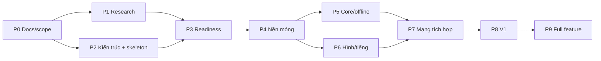

# Kế hoạch tổng viết lại engine Boom KR bằng Rust

Cập nhật: 2026-10-24 (chốt sáu issue RE theo câu hỏi, nghiệm thu V1 và fidelity còn lại).
Trước đó: 2026-10-23 (rà bằng chứng gate V1 G1–G6, việc còn thiếu và sổ pha/gate stale).
**Kế hoạch tổng hiện hành**, thay vai trò điều hành của
[REWRITE_PLAN_2026-10-19 cũ](../archive/plans/REWRITE_PLAN_2026-10-19.md).
Cập nhật: 2026-10-22 (hàng đợi RE theo consumer và giới hạn nguồn).
Cập nhật: 2026-10-20 (§Nguyên tắc fidelity: % feature done và số claim `confirmed` không phải
% fidelity; trỏ [SCOPE_V1 §10](SCOPE_V1.md#10-sai-khác-có-chủ-ý-so-với-client-gốc) và Q-009).
Trước đó: 2026-10-19.
Nguồn chuẩn về lộ trình, pha, hạn, dependency và việc tiếp theo.
Scope: [SCOPE_V1](SCOPE_V1.md). Quy tắc: [AGENTS.md](../../AGENTS.md). Repo: `boom-rs` ([ADR 0003](../decisions/0003-engine-repo-and-docs-home.md)).

## Mục tiêu và các quyết định đã có

Viết lại client và server Rust từ client KR còn lại, tái sử dụng tài nguyên đã trích và kiến thức RE.
Không cần tương thích wire protocol/client cũ. Server mới authoritative; legacy VN/emu giữ riêng
làm công cụ tham chiếu. Nền tảng desktop Windows/Linux/macOS; profile Việt hóa dùng font/chữ/ảnh
được duyệt. Server gốc thất lạc: phần không khôi phục được cần DESIGN có nguồn gốc và nghiệm thu.

V1 là lát cắt chơi được; mục tiêu dài hạn vẫn là mở rộng catalog KR. Không lấy V1 thu hẹp để tuyên bố
đã port đủ client gốc. Không dùng 520 opcode VN làm mẫu số tiến độ KR.

| Quyết định | Nguồn |
|---|---|
| Scope V1, policy phòng/vòng đời | [SCOPE_V1](SCOPE_V1.md), [ADR 0001](../decisions/0001-project-baseline.md) |
| VN dùng trực tiếp; giá trị ưu tiên KR confirmed → VN confirmed → BnB → design | [ADR 0002](../decisions/0002-vn-kr-trusted-sources.md), [ADR 0013](../decisions/0013-rule-source-precedence.md) |
| Repo `boom-rs` chứa engine + docs | [ADR 0003](../decisions/0003-engine-repo-and-docs-home.md) |
| Fixed step, số nguyên, RNG/hash riêng trong core | [ADR 0004](../decisions/0004-time-numeric-model.md) |
| Server quyết kết quả; client chỉ dự đoán di chuyển của mình | [ADR 0005](../decisions/0005-authority-and-prediction.md) |
| Transport mặc định TCP sau trait | [ADR 0006](../decisions/0006-transport-default.md) |
| Client stack: macroquad (có điều kiện) | [ADR 0010](../decisions/0010-client-stack-choice.md) (thay 0007) |
| Giao thức InputCommand/Snapshot, codec | [ADR 0009](../decisions/0009-wire-protocol-input-snapshot-codec.md) |
| Mở rộng qua Mode/System/Event, overlay luật, dữ liệu item/liveops | [ADR 0008](../decisions/0008-extensibility-model.md) |

### Nguồn chi tiết và trạng thái

| Cần biết | Nguồn chuẩn | Hiện trạng |
|---|---|---|
| V1 làm gì và policy | [SCOPE_V1](SCOPE_V1.md) | Đã chốt; trạng thái G1–G6 xem PROGRESS |
| Chức năng và dependency | [Catalog](../specification/FEATURE_CATALOG.md), [registry](../specification/features.json) | 114 mục: 37 V1, 75 later, 2 drop |
| Tiến độ so với catalog | [PROGRESS](PROGRESS.md), [execution.json](execution.json) | Generated |
| Luật chơi V1: claim và giá trị | [RULES_V1](../specification/gameplay/RULES_V1.md), `data/rules/v1-dev.toml` | Claim có nguồn/trạng thái; profile dev chạy được, chưa đủ phát hành |
| Câu hỏi mở | [QUESTIONS](../research/QUESTIONS.md), [sources](../research/sources/README.md) | Owner/ưu tiên/điều kiện đóng |
| Crate và contracts | [ARCHITECTURE](ARCHITECTURE.md) | `architecture-r1`; walking skeleton đã có trong `crates/` |
| Định danh client/asset | [Evidence](../evidence/README.md) | 13 pack/51.467 entry; 103 tài nguyên V1 fingerprint; closure còn thiếu |
| Giao task và review | [TEAM_WORKFLOW](TEAM_WORKFLOW.md) | Một owner mỗi task, reviewer khác owner |

## Pha hiện tại

Trạng thái pha lấy từ [execution.json](execution.json); trạng thái feature lấy từ
[features.json](../specification/features.json). Khối bên dưới được sinh tự động, không sửa tay.

<!-- PHASE_STATUS:START -->
Pha đang hoạt động: **P1 Tìm thông tin còn thiếu, P2 Cấu trúc dự án/interface, P3 Review sẵn sàng, P4 Nền móng/asset/oracle, P5 Core/offline, P6 Client hình/tiếng/input, P7 Authority/mạng/phòng, P8 Tích hợp/QA/phát hành V1**.

| Pha | Trạng thái | Owner | Đầu ra | Gate hoàn thành |
|---|---|---|---|---|
| P0 Tổ chức docs/scope | Đã nghiệm thu | integrator | Index, rules, registry, scope và migration | Nguồn chuẩn/link/tool rõ, giữ bằng chứng |
| P1 Tìm thông tin còn thiếu | Đang làm | research | Claim có nguồn trong RULES_V1, fixture và QUESTIONS cập nhật | Câu hỏi chặn kiến trúc có trả lời hoặc phương án kiểm chứng rõ |
| P2 Cấu trúc dự án/interface | Chờ review | architecture | ARCHITECTURE, contracts-r4, ADR protocol/client stack, harness scenario và CI ba OS | Boundary/contracts review và giả định quan trọng được ghi nhận |
| P3 Review sẵn sàng | Đang làm | integrator | Readiness và task prototype | Checklist readiness trong REWRITE_PLAN có kết luận |
| P4 Nền móng/asset/oracle | Chờ review | assets/RE | Workspace nhỏ, content resolver và oracle fixture | Legacy vẫn chạy, content unknown rõ và schema phù hợp |
| P5 Core/offline | Chờ review | core | Simulation/replay V1 | Rule scenarios/state hash tái lập và giới hạn nguồn rõ |
| P6 Client hình/tiếng/input | Đang làm | client | Scene/animation/render/audio/input | Content/presentation contract và acceptance tương ứng |
| P7 Authority/mạng/phòng | Đang làm | net/backend | Server/client round lifecycle | Authority/convergence, lifecycle và mạng có fixture |
| P8 Tích hợp/QA/phát hành V1 | Đang làm | integrator/QA | V1 end-to-end trên3OS | Tất cả37feature V1done và6gate releasepassed |
| P9 Mở rộng full feature | Chưa làm | integrator | Các đợt W1–W4 theo registry | Toàn bộ112mục trong baseline hiện hành done; scope mới phải revision riêng |
<!-- PHASE_STATUS:END -->

### Phát hiện lệch sổ pha/gate tại baseline `743e8ea9` (2026-10-23)

Tại baseline audit `743e8ea9`, [execution.json](execution.json) cập nhật **2026-10-19** ghi P1/P2
"Đang làm", P3–P8 "Chưa làm", cả sáu gate `open` và `evidence` rỗng, trong khi registry đã **35/37**
feature V1 `done` và các nhánh P4–P7 (asset/bundle, core, client, mạng) đã có code + scenario trên
`main`. Đây là **lịch sử lúc rà**; trạng thái hiện hành luôn đọc [execution.json](execution.json) và
[PROGRESS](PROGRESS.md), không lấy đoạn này làm sổ. Bảng G1–G6 ở mục “Rà bằng chứng gate V1” dưới đây
là **audit đọc** tại cùng baseline, không thay sổ chuẩn và không đuổi theo commit/PR mới.

Integrator cần kiểm và cập nhật, không suy trạng thái chỉ từ việc build xanh:

1. Đối chiếu từng feature V1 trong [features.json](../specification/features.json) với `main`:
   `implementation`, `integration_commit` (phải là ancestor của `main`), `evidence`, `review`,
   `blocker`. Tại baseline V1-035 và V1-036 còn `in_progress`; 35 mục còn lại đã `done`.
2. Đặt lại `status`, `owner`, `next_action` cho P1–P8 theo việc **đã merge và đã review**, không
   theo tên task cũ. `done` chỉ khi có integration commit trong HEAD, verification, evidence và
   reviewer độc lập approve (AGENTS §6); P8 không thể `done` trước khi đủ 37 feature và 6 gate.
3. Điền cho từng gate `release_gates[]`: `owner`, `reviewer`, `evidence` (file + commit/PR mở được),
   `verification` (lệnh + kết quả), `integration_commit`, `blocker`. Chỉ đổi `status` sang `passed`
   sau review độc lập; bảng audit dưới đây **không** phải evidence thay thế.
4. Sinh lại [PROGRESS](PROGRESS.md) bằng `python3 tools/kr_catalog.py`, rồi chạy
   `python3 tools/kr_catalog.py --check`; không sửa CSV/PROGRESS tay.
5. Giữ `baseline_scope_sha256` nếu scope không đổi; đổi scope phải có revision baseline riêng.
   Ghi ngày `updated_at` mới và lý do cập nhật trong commit/PR của integrator.

### Hạn của pha chuẩn bị

P1 và P2 có **hạn 2026-11-02**. Tới hạn, câu hỏi P1 còn mở được xử lý một trong ba cách:
chọn `design` có claim dẫn tới (ghi vào RULES_V1 + profile), chuyển thành thí nghiệm gắn task prototype,
hoặc ghi rõ là không chặn V1. Không gia hạn chỉ vì còn câu hỏi; gia hạn phải ghi lý do ở đây.
P3 (readiness) kết luận ngay sau hạn. Ngày này là đề xuất mặc định, người dùng có thể đổi.

### Dependency và song song

P1 không phải RE xong mọi thứ trước P4: câu hỏi tiếp tục được xử lý ngay trước task phụ thuộc.
P2 gồm walking skeleton (`boom-core`, `boom-content`, `boom-assets`, `boom-replay`, `xtask`) để chứng minh
boundary, nạp profile, replay hash và CI ba OS; skeleton không làm feature nào thành done.
P6 dùng state/animation fixture trước khi P5 hoàn chỉnh. Auth/lobby của P7 chạy song song P5/P6 sau khi
contract chốt; gate P7 cần core và client chạy chung.

Luồng song song theo pha (vai trò, chưa phải người cụ thể):

| Pha | Luồng chạy cùng lúc | Owner / reviewer |
|---|---|---|
| P1–P2 | START-A content closure; START-B luật/hiệu chuẩn; START-C contracts; skeleton | assets/RE, RE/core, core+net, integrator / QA |
| P4 | Asset pipeline Rust (pack → bundle); oracle fixture; profile dev đầy đủ | assets/RE / QA |
| P5 | Movement/collision; bom/lửa/chain; item; trapped/kết quả; replay | core / QA |
| P6 | Spike client stack (ADR 0007) → scene, animation, audio, input, Việt hóa | client / QA |
| P7 | Auth/session; phòng; authority + prediction; fixture mạng | net/backend + core / QA |
| P8 | Tích hợp end-to-end, build ba OS, báo cáo sai khác | integrator / QA |

## Nguyên tắc fidelity và đo nguồn

Theo [ADR 0013](../decisions/0013-rule-source-precedence.md), cùng đại lượng ưu tiên
KR 00967 confirmed → VN VBNB_116 confirmed → BnB `5c108e8` design → design riêng.
RE/decomp client KR là luồng ưu tiên; BnB bổ sung phần chưa có luật gốc.
Không đồng nhất packet trap với timer hoặc bước client với tick server; ngoại lệ Attr candidate xem ADR.

Mục tiêu giữ cảm giác và tài nguyên nguyên bản ở phần có nguồn xác nhận. Mỗi luật thuộc một trong:
**confirmed** (KR hoặc VN, ADR 0002), **candidate** (web, OSS, giá trị emu tự đặt), **design** (dự án chọn,
có claim dẫn tới) hoặc **unknown**. Profile drop Village00 V1 và Việt hóa là khác biệt có chủ ý, theo SCOPE_V1.

Trước khi dùng trace làm oracle, đo độ lặp của chính client nguồn; lưu build/patch/config emu,
trạng thái đầu, input thực nhận, clock/seed khi lấy được và giới hạn của debugger. Log emu hẹn fuse
không đo được fuse server gốc. Script xdotool/sleep chưa bảo đảm input cùng tick.

**Phần trăm không đo được fidelity.** Tỷ lệ feature `done` ([PROGRESS](PROGRESS.md)) và số claim
`confirmed` ([RULES_V1](../specification/gameplay/RULES_V1.md)) là **tiến độ dự án**, **không** phải
% giống client gốc. Sai khác có chủ ý và khoảng trống fidelity: [SCOPE_V1 §10](SCOPE_V1.md#10-sai-khác-có-chủ-ý-so-với-client-gốc);
kế hoạch lấy oracle (nguồn, độ lặp, cách lưu bằng chứng): **Q-009** trong [QUESTIONS](../research/QUESTIONS.md).

Nghiệm thu riêng: state/event theo rule và sai số đã đặc tả; pixel RGBA/ROI cho sprite/scene;
timing/side effect audio; input latency/focus; hội tụ và correction trong fixture mạng;
playtest tình huống chuẩn. `snapdiff.py` so snapshot bộ nhớ VM, không phải image diff.
Ngưỡng chính xác gắn fixture/nguồn hoặc quyết định DESIGN; không chép ngưỡng 0 px/99,5% của plan cũ.

## Rà bằng chứng gate V1 (2026-10-23) — audit lịch sử, không phải hàng đợi hiện hành

> **Trạng thái hiện hành sau PR271 (24/10):** V1-035 đã nghiệm thu, V1-036 `in_review`,
> **36/37** feature và **2/6** gate. PR213 đã merge; bảng 125khóa/57unknown/15review/9image-pending
> bên dưới là số tại baseline audit23/10, không phải yêu cầu duyệt lại hiện tại.
> V1 hiện có126khóa được nghiệm thu ở PR241; các sửa/review/QA sau audit xem
> [PROGRESS](PROGRESS.md), [execution.json](execution.json),
> [UI_STRINGS_V1](../specification/localization/UI_STRINGS_V1.md) và
> [gói QA hiện hành](../evidence/measurements/rust-client-ux-2026-10-24/package-current-qa.json).
> Giữ bảng lịch sử để đối chiếu; không nhận việc hoặc đổi gate theo trạng thái cũ trong bảng.

Mục này là **audit đọc** trên worktree `issue-208`, baseline `5dfcfe9a`; tại baseline audit (sau fetch
ngày 2026-10-23), `origin/main` ở `743e8ea9` (PR #209/#212 đã merge; PR #213 còn mở) và các commit/PR
**bằng chứng** dưới đây đã kiểm là merge vào `main` (riêng PR #177 ghi rõ đã đóng, không merge).
Trạng thái gate chuẩn vẫn là [execution.json](execution.json)/[PROGRESS](PROGRESS.md); tại baseline
audit tất cả `open`, trạng thái hiện hành luôn đọc generated/JSON; **không gate nào được tuyên bố
passed ở đây**. Ba mức tách riêng: feature `done` (registry + acceptance) ≠ gate `passed` (evidence +
reviewer độc lập) ≠ fidelity (oracle/playtest). Build xanh, smoke 3 OS và regression test **không**
thay bằng chứng fidelity hoặc QA người chơi.

**Bảng lịch sử tại baseline audit23/10.** Bảng trả lời: gate yêu cầu gì ([SCOPE_V1 §6](SCOPE_V1.md#6-gate-còn-mở-owner-và-bằng-chứng-nghiệm-thu)),
bằng chứng nào **đã tích hợp**, phần nào còn thiếu, bước/owner đề xuất. Cột “Thiếu” chỉ nêu việc chưa
có; không hạ/nâng nhãn claim và không thay sổ chuẩn.

| Gate | Nghiệm thu (SCOPE_V1 §6) | Bằng chứng đã tích hợp (file + commit/PR) | Còn thiếu | Việc tiếp theo / owner đề xuất |
|---|---|---|---|---|
| **G1** content/map | Decode dependency tile/object và collision; resolve toàn state render; không skip `unknown` âm thầm; spawn không bị chặn và có đường thoát. | [BUNDLES §6.1](../specification/assets/BUNDLES.md#61-bốn-state-unknown-của-bundle-đã-giải-bằng-bảng-state-của-client-issue-121): bundle Village00 **0 mục `unknown` nội dung** (4 state giải bằng `design` R-086/R-094; 47/47 clip vẫn `timing.unknown`); [village00-kr.toml](../../data/maps/village00-kr.toml) phân loại từ `ObjectTable` + 5.929 `TileInfo` (`kr_static`/confirmed, PR [#25](https://github.com/aquaplatinumberlitz/boom-rs/pull/25), commit nội dung `97a59d8`); test 4 spawn khác nhau, không chặn, có đường thoát ở [bundle.rs](../../crates/boom-assets/src/bundle.rs#L1699) (PR [#126](https://github.com/aquaplatinumberlitz/boom-rs/pull/126), `891c7c7d`); manifest closure [closure.rs](../../crates/boom-assets/src/closure.rs). | **Fidelity gap**, không phải blocker tự động: chưa có trace consumer client cho cách dùng lớp ô (`TileInfo.Data`, object/event) và script map; [SCOPE_V1 §2](SCOPE_V1.md#2-nội-dung-đã-chọn-và-khác-biệt-có-chủ-ý) ghi rõ metadata chưa chứng minh hết loader/collision. Test spawn chạy trên bảng phân loại của engine, không phải client gốc. Chưa có reviewer gate độc lập. Theo SCOPE §4, unknown có thể giải bằng RE **hoặc** DESIGN có nguồn/acceptance; gate không bắt RE xong trước. | assets/RE tiếp tục trace consumer nếu còn đường; nếu dừng, integrator/rule owner ghi DESIGN + phạm vi/acceptance cho phần map script/collision, reviewer độc lập chấp nhận. QA nhận test spawn/path; integrator điền `evidence` + reviewer. Owner: assets/RE, reviewer QA. |
| **G2** movement/stats | C00/C01→Attr; tốc độ/hitbox/cornering/time model có trace **hoặc** DESIGN đã ghi nhận. | Movement/hộp/corner: [movement.rs](../../crates/boom-core/src/systems/movement.rs), scenario [movement/](../../fixtures/scenarios/movement) (PR [#140](https://github.com/aquaplatinumberlitz/boom-rs/pull/140), `b26c88c`); bomb-pass R-154 (PR [#205](https://github.com/aquaplatinumberlitz/boom-rs/pull/205), `1431854`); RE KR hộp 40×40/corner R-119…R-125 (PR [#152](https://github.com/aquaplatinumberlitz/boom-rs/pull/152), `abd53641`); time model R-113/ADR 0004; sai khác G-06/G-07 ở [ORACLE_REPORT](../research/ORACLE_REPORT.md); giá trị profile [v1-dev.toml](../../data/rules/v1-dev.toml). | **DESIGN hiện hành đã chọn/review**, không đòi trace bomber trước khi qua G2: tick 30 Hz (R-113), speed 24 px/s mỗi cấp (R-114), hộp/trợ góc/chạm 13/12/28 px (R-116), Attr C00/C01 giữ target (R-117 `candidate` có chủ ý) theo ADR 0013/R-110…R-118. **Fidelity gap riêng:** chưa có mover/hitbox/speed của bomber thật; R-119…R-122 và R-154 chỉ confirmed trong phạm vi `CMovable`/predicate + consumer pet/AI — R-154 **không** xác nhận bomb-pass bomber; R-123 mới là dispatch bomber, chưa nối mover; R-125 còn `unknown`. **Gate gap:** profile `release=false` và reviewer chưa sign-off việc áp values design sang bomber; G-06/G-07 vẫn là sai khác đã ghi. | dsh [#146](https://github.com/aquaplatinumberlitz/boom-rs/issues/146) tiếp tục trace mover bomber khi có đường, ghi `unknown` nếu dừng; integrator/rule owner giữ DESIGN trong SCOPE §10/profile, nêu rõ pet/AI ≠ bomber, và reviewer độc lập sign-off. QA giữ scenario active. Không mở lại thiết kế/game code trong audit này; fidelity gap không biến thành điều kiện RE bắt buộc. Owner: RE/core, reviewer QA. |
| **G3** bomb/damage/items | Fuse/chain/flame/trap/cap và profile drop V1 có nguồn/version cùng boundary scenarios; gồm match duration/**clock start**. | Scenario **active**: [bomb_place/](../../fixtures/scenarios/bomb_place), [explosion/](../../fixtures/scenarios/explosion), [life/](../../fixtures/scenarios/life), [blocks/](../../fixtures/scenarios/blocks), [round/](../../fixtures/scenarios/round); core PR [#143](https://github.com/aquaplatinumberlitz/boom-rs/pull/143) (`8bc88e1`); item rơi/cap PR [#160](https://github.com/aquaplatinumberlitz/boom-rs/pull/160) (`ee779e4`); nổ lan R-139/R-140 PR [#193](https://github.com/aquaplatinumberlitz/boom-rs/pull/193); timer nhốt R-200…R-202 PR [#195](https://github.com/aquaplatinumberlitz/boom-rs/pull/195); profile [v1-dev.toml](../../data/rules/v1-dev.toml#L6) đang `release = false`; R-112/R-113. | Các giá trị đang dùng — fuse 2,5 s, nhốt 4 s, drop 35%, tick 30 Hz — là `oss`/design **đã chọn** qua R-110…R-118 và review (R-112/R-113/R-115), không phải blocker “thiếu RE”. **Lệch diễn đạt cần sửa:** SCOPE §6 ghi “Clock bắt đầu khi loading barrier hoàn tất”, trong khi R-100/R-113 chốt warmup 3 s đóng băng, **không ăn vào clock lượt**; code tính clock **lượt** sau `warmup_ticks` ([sim.rs](../../crates/boom-core/src/sim.rs#L277), [mode.rs](../../crates/boom-core/src/mode.rs#L72)) khớp quyết định hiện hành. Đây là lỗi câu chữ SCOPE, không phải thiết kế/game code mới. Còn thiếu sign-off profile (`release=false`) và review boundary scenarios. | rule owner/integrator sửa câu SCOPE §6 cho khớp R-100/R-113 (warmup không ăn vào clock lượt) trong PR docs riêng; **không** đổi code/design trong audit này. Rule owner/reviewer sign-off profile rồi mới `release = true`; QA giữ scenario active. Owner: rule/integrator + QA. |
| **G4** protocol/state | Command window/sequence, snapshot, RNG/state hash, authority và reconciliation contract. | [ADR 0005](../decisions/0005-authority-and-prediction.md), [ADR 0009](../decisions/0009-wire-protocol-input-snapshot-codec.md); predict/correction [prediction.rs](../../crates/boom-client/src/net/prediction.rs) (PR [#172](https://github.com/aquaplatinumberlitz/boom-rs/pull/172), `26435d0`), recovery PR [#174](https://github.com/aquaplatinumberlitz/boom-rs/pull/174) (`b9c9427`); replay/state hash V1-026 [main.rs](../../crates/boom-replay/src/main.rs); harness + **ma trận 2/4 client × seed 1/2/3** ở [QA_NETWORK](../specification/QA_NETWORK.md) (PR [#212](https://github.com/aquaplatinumberlitz/boom-rs/pull/212), `743e8ea9`, đo tại `14318549`); scenario [round/](../../fixtures/scenarios/round). | Ma trận release **đã chạy đủ 6/6** (2/4 × 3 seed): cả sáu exit 0, hội tụ, đủ hash, drained, không timeout; p95 có mẫu. Không còn giữ “chưa chạy đủ ma trận” là việc chưa làm. Gate vẫn cần: reviewer đọc số đo và giải thích `input.rejected` 28/62 (harness không coi là lỗi); xác nhận p95 chỉ là regression của bản Rust, **không phải** ngân sách latency/fidelity; review contract/authority/reconciliation và sign-off. Recovery/liveness là test riêng, không suy từ Steady. | QA/người đo giữ lệnh + JSON/log hash (local ignored) và trả lời rejected; net/core reviewer kiểm contract, authority, recovery, p95; integrator điền evidence G4 + sign-off. Owner: QA + net, reviewer core. |
| **G5** UX/localization | Chốt UI/SFX/font/ảnh cho luồng V1; glyph/wrap/focus/golden đúng profile Việt hóa. | Luồng UI mạng PR [#171](https://github.com/aquaplatinumberlitz/boom-rs/pull/171) (`395a7bc`); mọi chữ qua l10n PR [#188](https://github.com/aquaplatinumberlitz/boom-rs/pull/188) (`82033ce`); font/wrap + golden layout chữ PR [#116](https://github.com/aquaplatinumberlitz/boom-rs/pull/116) (`316a88e`); audio trong `Game::tick` PR [#170](https://github.com/aquaplatinumberlitz/boom-rs/pull/170) (`eff7f94`) và consumer event R-203…R-208 PR [#200](https://github.com/aquaplatinumberlitz/boom-rs/pull/200) (`bbf7596`); trang review 125 khóa V1 PR [#209](https://github.com/aquaplatinumberlitz/boom-rs/pull/209) (`6ad3e062`); danh mục 125 khóa ở [UI_STRINGS_V1](../specification/localization/UI_STRINGS_V1.md), mapping ở [AUDIO_V1](../specification/assets/AUDIO_V1.md). | Trang review 125 khóa **đã có** (PR #209, `6ad3e062`), [#207](https://github.com/aquaplatinumberlitz/boom-rs/issues/207) đã đóng; không còn là việc chưa làm. **Trong 125 khóa V1** còn 57 `unknown`, 15 `review`, 9 `image-pending` (8 ảnh UI có chữ); người duyệt chưa chốt khóa/ảnh dùng thật hoặc text fallback. **3.038 ảnh `pending` là toàn catalog**, không phải toàn bộ scope V1 và không tự chặn V1; chỉ ảnh thực dùng trên đường V1 (hoặc fallback đã duyệt) mới cần. Tương tự 23 mục review toàn catalog không biến thành 23 mục V1. `player_trapped` vẫn map `Wave/Itm_UseTrap`; PR [#213](https://github.com/aquaplatinumberlitz/boom-rs/pull/213) (`f26a0726`) đang mở để đổi `Wave/Cha_LockedIn` theo R-204, **chưa merge**. Chưa có golden ảnh khung 800×600/1920×1080 và focus; golden layout chữ đã có. | Chủ dự án duyệt qua trang review/tool §6.2 và [IMAGE_REVIEW](../specification/localization/IMAGE_REVIEW.md): chốt 57/15/9 khóa/ảnh nào thực dùng hoặc fallback; thiếu thì sửa `boom-re-l10n`, không tự soạn. Reviewer xác nhận chỉ V1 path. Review/merge PR #213; client làm golden khung/focus. Owner: client/l10n + QA, người duyệt nội dung. |
| **G6** release | Tất cả **37** mục qua acceptance; build/chạy 3 OS; sai khác được ghi nhận và chấp nhận. | Registry **35/37** V1 `done` ([features.json](../specification/features.json), [PROGRESS](PROGRESS.md)); V1-035 và V1-036 còn `in_progress`. Gói/smoke 3 OS: PR [#110](https://github.com/aquaplatinumberlitz/boom-rs/pull/110) (`9420458`), [#128](https://github.com/aquaplatinumberlitz/boom-rs/pull/128) (`d6ca5799`), [#168](https://github.com/aquaplatinumberlitz/boom-rs/pull/168) (`303ab49`); sai khác D-01…D-08/G-01…G-11 ở [SCOPE_V1 §10](SCOPE_V1.md#10-sai-khác-có-chủ-ý-so-với-client-gốc) và [ORACLE_REPORT](../research/ORACLE_REPORT.md). | V1-035 chưa có approval text/ảnh của người duyệt qua đúng quy trình (trang review đã có, #207 đóng — chờ quyết định, không tự đánh dấu). V1-036 đã có package/smoke 3 OS nhưng còn dependency V1-035 và cần chạy lại/xác nhận smoke sau khi V1-035 done. Chưa có reviewer sign-off 6 gate, chưa có playtest/QA người chơi hoặc đo fidelity. 35/37 **không** phải “gần đủ để phát hành”. | Tại baseline G6 vẫn `open`; **không đặt `passed` trước khi đủ điều kiện**: chủ dự án duyệt V1-035 qua quy trình; sau đó V1-036 chạy lại smoke 3 OS; integrator + QA rà đủ 37 acceptance và G1–G5 rồi mới review G6. Owner: integrator/QA. |

**Đọc kết quả:** không gate nào passed; việc còn chặn là sign-off/duyệt nội dung và profile release,
**không** phải đòi RE xong. (1) V1-035 chờ người duyệt text/ảnh — không được thay bằng “code đã xong”
hay bằng trang review đã có. (2) G2 đã có DESIGN hiện hành theo ADR 0013/R-110…R-118; mover/hitbox/speed
của bomber thật vẫn là **fidelity gap** (R-119…R-122/R-154 chỉ tới `CMovable`/pet/AI; R-123 mới là
dispatch bomber), nhưng không tự thành blocker nếu DESIGN được reviewer chấp nhận; thiếu
sign-off/profile release. (3) G3 cần sửa câu
SCOPE về clock cho khớp R-100/R-113 — clock lượt sau warmup — và sign-off profile `release = false`;
không phải mở thiết kế/game code mới. (4) G4 đã chạy đủ ma trận 2/4 × 3 seed, 6/6 hội tụ; còn review
số đo, `input.rejected` và sign-off, không phải chạy lại; p95 không phải latency budget/fidelity.
(5) G5 chỉ cần chốt chữ/ảnh **thực dùng trên đường V1** hoặc fallback; 3.038 ảnh `pending` là toàn
catalog, không chặn V1; PR #213 đang mở, chưa merge. (6) G1: trace consumer/script map là fidelity gap;
cần DESIGN/acceptance rõ và reviewer sign-off, không bắt RE xong. Build 3 OS xanh và smoke gói chỉ là
điều kiện **cần**, không phải bằng chứng người chơi/fidelity. Khi integrator cập nhật sổ, mỗi dòng gate
phải có file + commit/PR mở được, lệnh kiểm và reviewer; bảng này không thay thế review đó.

## Server thiếu nguồn: khôi phục hoặc thiết kế lại

Theo từng hành vi: dữ liệu/code client → đo runtime → guide/patch/video có build-region → DESIGN.
Legacy là mô hình lai: server quyết fuse, item ẩn và xác nhận nhặt; client quyết di chuyển, vỡ gạch,
nhốt và chết ([ADR 0005](../decisions/0005-authority-and-prediction.md)). Server mới quyết tất cả;
phần client gốc tự quyết là nơi cần đo feel kỹ nhất.

V1 chỉ cần identity, session, room/match, validation và trạng thái trận theo scope.
Economy/ledger/inventory/guild/liveops giữ trong backlog sau V1. Không chép server giả lập thành backend.
Khi mở economy phải có transaction/idempotency, ownership và nguồn balance (Q-011).

## Việc tiếp theo — đợt 1 (GitHub issues)

### Điều phối sáu issue RE và nghiệm thu V1 (2026-10-24)

Quyết định chủ dự án trong task [#253](https://github.com/aquaplatinumberlitz/boom-rs/issues/253):
chốt phần cần cho V1 và tiếp tục phần fidelity bằng câu hỏi có điểm dừng. Giữ nguyên scope, thứ tự
nguồn ADR 0013 và acceptance gốc của sáu issue; hoàn thành một phép đo không tự đóng issue gốc.
Task đo hẹp #240 đã nghiệm thu, PR #249 đã tích hợp R-155/R-156/R-158. Không giao lại owner grace
hoặc đo lại cửa sổ lửa đã có chỉ để giảm số issue.

| Luồng / thứ tự | Issue | Câu hỏi cần chốt | Nghiệm thu V1 và phần fidelity còn lại |
|---|---|---|---|
| DSH1 — gameplay hiện hành | #149 rồi #146 | Hoàn tất capacity, sau đó Roller → cấp → vận tốc thực trên cùng receiver | Capacity R-168 đã tích hợp PR264; Roller đổi vận tốc cùng actor R-169 đã tích hợp PR268. Native getter R-170 đã đo return5→6 sau một Roller; R-171 bổ sung hai cặp actualv244amount5/6→Ydelta−5/−6; R-172 đo protectedC64 plateau7 qua12Roller, getter cuối7 và nativeXY control, chỉ mộtactorVN. Câu hỏi tiếp là writer/maxfield/cadence hoặc ánh xạactor/level; actualcaller131E9DF khác giả định5A1035. Không đo lại capacity/getter/plateau case hoặc đổi tên số pixel thành level. |
| DSH2 — presentation native hiện hành | #196 hoặc #150 | Một cạnh có nguồn cụ thể: helper init voice count/receiver hoặc consumer tên/layout | R-212/count và R-213/EOS đã tích hợp PR266/269. Cạnh hiện tại là consumer tiếng gạch vỡ; UI giữ thiếu writer/identity có điều kiện mở lại. Không quét lại init/597soundcalls hoặc giao lại duyệt V1-035. |
| Chỉ mở khi có ca kiểm chứng mới | #147 / #148 | Input/touch/non-owner hoặc nhánh damage/render chưa được đo | R-155/R-156/R-158/R-159/R-160/R-161 đã có; không đo lại owner grace, cửa sổ lửa, endpoint nhốt chỉ để giảm số issue. |
| Codex song song | G2/G3/G5 và V1-036 | Audit source/profile/acceptance; gói QA đúng luật hiện hành; GUI/hardware blocker cụ thể | Không bắt V1 chờ hết sáu root RE; không đổi candidate/unknown thành confirmed hoặc tự nâng gatepassed. [Gói QA40091603701](https://github.com/aquaplatinumberlitz/boom-rs/blob/265432d8b5d24df26daea74df8d37855a292a3d8/docs/evidence/measurements/rust-client-ux-2026-10-24/package-current-qa.json) đã kiểm luật6350/17/540; PR271 sửa fullscreenKWin sau gói đó. Gói cuối phải theo head phát hành thực, không chạy lại chỉ vì thêm docsRE. |

Chỉ dùng **hai session dsh hiện có**. Mỗi luồng làm tuần tự; Codex giữ RULES_V1, QUESTIONS,
index, profile và ledger; worker trả evidence riêng, không sửa chung các file này. Không dùng OpenCode
trong đợt này; chỉ mở lại khi chủ dự án cho phép mới. Không mua quota, đổi provider hoặc mở thêm session
để né hạn mức.
Một actor/base-function cache cùng SHA được chia sẻ giữa hai luồng; chỉ một owner phân tích thân mới.

Mỗi lượt có một câu hỏi, baseline/build/SHA, owner file, reviewer và phép nghiệm thu:

Mỗi task là **một câu hỏi có điểm kết thúc**: ghi câu hỏi, cache/điều đã biết, cạnh hoặc hypothesis mới,
bằng chứng đủ kết luận, ngân sách/điều kiện dừng/fileowner, kết quả confirmed/candidate/unknown và bước tiếp.
Đối với hành vi speed/cap/trapped/collision/damage, dùng phép đo offline có đối chứng sớm nếu truy tĩnh
không tiến; tĩnh tìm điểm quan sát/giải thích cơ chế. Có thể thu nhiều đại lượng liên quan trong một run,
nhưng mỗi kết luận phải có đối chứng riêng, native quantity/đơn vị/sai số/build/patch; không dùng keydown,
lịch emu hay packet clock thay thời điểm hành vi native. Gom phát hiện trong cùng câu hỏi thành PR đủ review;
kiểm wording trước push và review độc lập song song CI, không thêm vòng tích hợp cho từng snippet.

1. Reuse cache; kiểm đúng receiver/build trước khi truy. Mốc **8 yêu cầu phân tích / 4 thân hàm mới**;
   đọc bằng REA, IDA hoặc objdump đều tính thân mới. Đọc lại cache đúng SHA không phải phát hiện mới.
2. Thử 2–3 hướng có căn cứ. Hai lần lặp cùng đường không có bằng chứng mới thì dừng nhánh và hỏi
   Codex; không retry mù lỗi `retryable:false`, capability thiếu hoặc entry VM đã biết.
3. Codex đọc raw và giải blocker tại checkpoint. Cấp thêm chỉ khi nêu cạnh mới, câu hỏi và ngân sách
   bổ sung cụ thể. Runtime VN offline có một owner thực thi tại một thời điểm, copy/namespace/PID riêng.
4. Sau **hai lượt không có tiến triển**, Codex ghi quyết định: đổi sang phép đo động có đối chứng;
   chọn DESIGN có nguồn/acceptance và reviewer; hoặc hoãn phần fidelity. Mục hoãn có owner, lý do,
   điều kiện mở lại và link Q/issue; không tiếp tục quét để tìm lại mỏ neo cũ.
5. Worker bàn giao cả kết quả dương, phạm vi âm và phần chưa biết. Chỉ lập PR khi có evidence/đầu ra
   mới; không tạo PR chỉ lặp unknown. Review đúng head + CI ba OS + safe-merge trước tích hợp.

#### Hợp đồng phép đo dùng lại — chủ dự án chấp thuận 2026-10-24

Với câu hỏi hành vi, chuỗi thực hiện là **tĩnh chọn điểm quan sát → động có đối chứng → tĩnh giải thích**.
DSH1 chuẩn bị consumer/probe gameplay; DSH2 làm presentation có đầu vào rõ và review độc lập;
Codex giữ một runtime owner, kiểm raw và xử lý lỗi harness. Giữ hai session; chỉ tăng nhân lực khi có
câu hỏi độc lập đủ đầu vào và năng lực review, không tăng để bù lỗi setup hoặc tranh runtime.

Một harness được dùng lại qua các câu hỏi, với kiểm trước chạy:

- Build/hash/patch đúng; PID/network/display/log và gamecopy riêng. Bootstrap chỉ theo actual actor/type,
  không bắt đầu ngân sách bắt nhân vật từ màn đăng nhập hoặc phụ thuộc tọa độ giả định.
- `ready` cần đúng actor và dữ liệu native hợp lệ; marker khởi tạo hook, stage hoặc packet giả lập chưa đủ.
  Xác nhận debugger đúng kiến trúc và ACK mới của từng lệnh; không nhận prompt cũ làm ACK.
- Breakpoint tự tiếp tục vẫn gây trap/observer overhead. Ghi số hit/stop thực, tắt ngay sau capture;
  đo thời gian phải loại hoặc định lượng ảnh hưởng debugger. Không đặt hook toàn cục mỗi frame để đo vận tốc.
- Sau hai lỗi setup, worker dừng chạy lại và giao raw cho Codex sửa nguyên nhân đã xác định.
  Chỉ chạy lại khi input/method đã đổi có lý do; lỗi setup không là bằng chứng âm của gameplay.
- Một run có thể lấy level/getter, bước, vị trí và item liên quan; mỗi đại lượng có đối chứng/đơn vị/sai số
  riêng. Reuse kết quả đã nghiệm thu và giữ cả dữ liệu lỗi; không chạy lại chỉ để có con số đẹp.

Điểm kết thúc của một câu hỏi là kết luận có phạm vi + bằng chứng/unknown còn lại + bước tiếp;
Codex review và chọn bước kế sau checkpoint/PR, không để worker chờ toàn bộ CI. Một câu hỏi thành
một PR đủ review, không chia theo snippet hoặc gom chủ đề không liên quan. Không hạ chuẩn exact-head
approval, CI ba OS và safe-merge; không tăng % hoặc pass gate theo số lượt RE.

Mỗi issue gốc có checklist câu hỏi **đã trả lời / đang làm / chưa biết / hoãn có điều kiện**. Số câu
hỏi được trả lời là tiến độ research riêng, không cộng vào feature % và không gọi là % fidelity.
Chỉ đóng issue gốc khi acceptance gốc đã đạt hoặc có quyết định đổi phạm vi được ghi rõ; phần native
chưa hoàn thành không được đổi nhãn thành confirmed/done để đóng issue.

Codex làm **G5 và V1-036 song song với RE**: kiểm focus/nhả phím, integer scale/cửa sổ/fullscreen,
keybind, volume/mute, SFX/BGM và luồng Việt hóa thật; chuẩn bị archive + smoke ba OS từ code đã review.
G2/G3/G5 cần sign-off độc lập cho source/profile/acceptance hiện hành. Giữ rõ llvmpipe, thiết bị audio
ảo và giới hạn phần cứng; package smoke không thay nghiệm thu UX hoặc fidelity. Chỉ cập nhật G6/P8
khi mọi dependency/feature/gate thực sự đạt, không yêu cầu RE hết các mode later.

### Các cạnh RE tham chiếu (lập 2026-10-22)

Bảng dưới giữ các cạnh/caller tham chiếu; ưu tiên và hai luồng hiện hành lấy từ mục điều phối 2026-10-24
ở trên. Owner **dsh-RE**, reviewer Claude/Codex; từng luồng làm tuần tự trong session cố định.
Ưu tiên theo ảnh hưởng gameplay V1 và đường consumer có thể truy tiếp, không theo số issue hay
số asset. Đây là hàng đợi trong kế hoạch hiện hành, không mở scope hoặc tăng tỷ lệ feature done.
Nguồn backlog: [QUESTIONS](../research/QUESTIONS.md), [RULES_V1](../specification/gameplay/RULES_V1.md),
[SCOPE_V1 §10](SCOPE_V1.md#10-sai-khác-có-chủ-ý-so-với-client-gốc),
[BUNDLES §6–8](../specification/assets/BUNDLES.md), [AUDIO_V1](../specification/assets/AUDIO_V1.md).

**Điểm xuất phát (rà 2026-10-23):** PR [#152](https://github.com/aquaplatinumberlitz/boom-rs/pull/152)
(movement, `abd53641`), [#157](https://github.com/aquaplatinumberlitz/boom-rs/pull/157) (trapped,
`77815ae6`), [#181](https://github.com/aquaplatinumberlitz/boom-rs/pull/181) (item, `5296582f`),
[#175](https://github.com/aquaplatinumberlitz/boom-rs/pull/175) (flame, `d2e3aa49`) và
[#185](https://github.com/aquaplatinumberlitz/boom-rs/pull/185) (trapped dir/len, `6feffcf`) **đã merge**;
kết quả nằm trong `main`, không còn trạng thái “đang review”. PR [#175](https://github.com/aquaplatinumberlitz/boom-rs/pull/175) đã nhập mỏ neo; PR
[#193](https://github.com/aquaplatinumberlitz/boom-rs/pull/193) sau đó bổ sung consumer nổ lan/chain
R-139/R-140; [#204](https://github.com/aquaplatinumberlitz/boom-rs/pull/204) (item reader) và
[#205](https://github.com/aquaplatinumberlitz/boom-rs/pull/205) (bomb-pass R-154) cũng đã merge. Còn
frame/duration R-151 và consumer bomber của movement mở.
PR [#177](https://github.com/aquaplatinumberlitz/boom-rs/pull/177) **đã đóng, không merge**; cổng không
chặn **không** tự chứng minh quãng đi dương. Lượt bổ sung #185 đã truy đường
`0x00B95180`/`0x00B93830` từ vtable **CGOPet**, chưa nối được tới bomber người chơi; đây là kết quả
**đã tích hợp**, đủ để không áp các claim ấy lên bomber trước khi kiểm lại phạm vi. Cần reviewer xử lý
ảnh hưởng R-119…R-122/R-126…R-130 trong #152/#157 khi sửa core; không chỉ sửa số tốc độ trong #177.
Lượt 1 dưới đây là **bước tiếp theo đề xuất sau #185**; dsh chỉ nhận khi điều phối giao issue/phạm vi cụ thể.

| Thứ tự | Task nhỏ có thể giao | Câu hỏi / issue gốc | Điểm bắt đầu và đầu ra cần có |
|---|---|---|---|
| 1 — cần giao tiếp | **Mover đúng của bomber, tốc độ và quãng đi khi nhốt** | Q-004/Q-005/Q-017/Q-018; [#146](https://github.com/aquaplatinumberlitz/boom-rs/issues/146), [#147](https://github.com/aquaplatinumberlitz/boom-rs/issues/147); mở lại implementation movement (PR #177 đã đóng) | Theo PR #185: `CGameContext` `0x00E13D00` đưa dir vào sub-object **nhúng** tại bomber byte `+1412` (VN `+1524`); xác minh vtable/đúng lớp, đọc setter hướng rồi truy reader tới setter vị trí. Mỏ neo update bomber: `CGOGameBomber` slot 24 `0x00B77B10`, `CGOBomber` slot 24 `0x00B44000`, getter vị trí `0x00B335C0`/`0x00B335E0` (tất cả cần đối chiếu phạm vi). Không quay lại lấy `+0xE0`/`+0xD4` của pet làm controller bomber. Trả đường input→vị trí, công thức/quãng đi theo cấp, điều kiện quãng đi khi nhốt và nhịp gọi; chưa biết nhịp thì chỉ ghi px/bước. |
| 2 | **Collision và bomb-pass** | Q-005/Q-017; #146; V1-011/012/013 | Đi từ mover bomber đúng của lượt 1 tới truy vấn ô/vật cản; `CMovable::MoveSimple` `0x01310200` và `0x00B93890` của #152 chỉ là đầu mối AI/pet sau #185, chưa phải consumer bomber. Chốt polarity ô chặn/đi được, hộp và mốc toạ độ, điều kiện trợ góc, bom vừa đặt cho ai đi ra và lúc nào mất pass. Đối chiếu tường/gạch/bom và C00/C01; không đổi hộp bomber thành 40×40 hay nửa hộp 20 px từ consumer chưa thuộc lớp đó. |
| 3 | **BomberAttr và hiệu ứng/cap của ba item V1** | Q-005/Q-007/Q-020; [#149](https://github.com/aquaplatinumberlitz/boom-rs/issues/149); V1-017/018/019 | Từ getter/consumer speed vừa tìm, `CBomberAttr` `0x0134FD40`, bomber vtable `0x01745FE8`; lần nhánh áp Bomb/Fire/Roller sau xác nhận pickup. Cần ánh xạ f2–f7 vào base/max có consumer, phép tăng/kẹp, và xử lý nhặt tại cap; chỉ có dãy số hoặc loader chưa đủ. Không đánh đồng Roller với Shoe. |
| 4 | **Timer nhốt, chạm/chọc và biên chuyển life** | Q-006/Q-018; #147; V1-020 | Từ handler hàng đợi defer, tên `DeferBomberLockedIn`/`DeferBomberReleaseOrDie` và state machine **đã xác minh thuộc bomber**. Không lấy state machine trong cụm pet `0x00B95xxx` làm bằng chứng bomber sau #185. Tìm setter/tăng-giảm timer với đơn vị, điều kiện kiểm chạm, khoảng cách/hộp, thứ tự hết hạn với chạm/lửa trong cùng bước. VN-B01/R-028 đã xác nhận chạm địch làm chết: không đo lại chỉ vì khác region; chỉ truy phần định lượng/ordering còn thiếu. Cứu đồng đội/kim ghi tham chiếu, không tự mở scope V1 FFA. |
| 5 | **Propagation/chain và thời gian gây damage của lửa** | Q-006/Q-019; [#148](https://github.com/aquaplatinumberlitz/boom-rs/issues/148); V1-014/015 | Theo đường nhận nổ và consumer bom/lưới, đối chiếu VN `oc_e-game` §5a. Chốt ô đầu/cuối tia, tường/gạch/bom chặn hay xuyên, nhánh kích nổ dây chuyền và thời gian vùng gây damage. Phân biệt damage TTL với animation; không lấy fuse 2,5 s của emulator làm fuse gốc. Nếu client chỉ nhận quyết định server thì ghi ranh giới đó, không suy luật server thất lạc. |
| 6 | **State → animation và thời lượng frame** | Q-003/Q-019; #148; V1-031 | Đi từ ODT R-094 (C00/C01 90 state) qua parser/template `0x00BA3530`/`0x00BA40F0`/`0x00BA41D0`/`0x00BA42F0` tới consumer `(frame,duration)`/elapsed. Cần đơn vị duration, loop/hold/end, state thật cho idle/trapped/dead và cách chọn tâm/thân/đuôi/hướng lửa. Không RE lại blob frame để tìm ms: blob đã không có trường thời gian; không mặc định 100 ms của V1 là gốc. Vtable effect khác mode chỉ là đầu mối, phải chứng minh consumer áp dụng Battle thường. |
| 7 | **Neo ảnh, canvas/pivot, lớp và blend** | Q-002/Q-003; V1-030/031; cần task RE riêng khi giao | Đối chiếu đường render VN `CDataI16Alpha` từ `0x00A3D850` sang KR. Lấy công thức dùng f0/f1/f2/f8…f11, thứ tự `Static`/`Adjust`, clipping/alpha và quan hệ với vị trí thế giới. PR [#203](https://github.com/aquaplatinumberlitz/boom-rs/pull/203) (`5dfcfe9`) đã mở accessor/neo tile nhưng chưa có draw pass; BUNDLES §7 hiện là design; kiểm decoder khớp tool tham chiếu không chứng minh consumer render đúng. Chọn vài sprite Village00 + C00/C01 làm ca đối chiếu, không quét toàn bộ asset. |
| 8 | **Consumer âm thanh cho event V1** | Q-015; V1-034; [#196](https://github.com/aquaplatinumberlitz/boom-rs/issues/196); task RE riêng khi giao | Xref `Wave/%s`, `BombExplosion%03d` và các entry ở AUDIO_V1 tới hàm phát sound. Chốt entry cho nổ/nhốt/chết/nhặt/vỡ gạch, cách chọn biến thể, BGM và policy voice nếu đọc được. Asset có tên/cùng hash không chứng minh event chọn nó; 8 voice/dedup hiện là design. Có thể chuyển lên trước lượt 7 nếu đã thấy caller trực tiếp hoặc nhánh render bị VM chặn. |
| 9 | **UI V1, tọa độ và locator chữ/tên nhân vật** | Q-012/Q-021; [#150](https://github.com/aquaplatinumberlitz/boom-rs/issues/150); V1-032/033/035 | Chỉ login→lobby→room→match→result: consumer layout, kích thước render/native framebuffer, hitbox/focus/scale, resource/key thật và C00/C01→tên. JPEG 800×600 không tự chứng minh framebuffer thật. Trả locator cho khóa thiếu, không tự viết lại bản dịch hoặc duyệt ảnh thay người. Không mở quảng trường/shop/mode later. |
| 10 — có điều kiện | **Vai trò ItemAttr/drop-table/placement** | Q-007/Q-020; #149; V1-016 | Tiếp `sub_1196A70` `0x01196A70`, reader của vùng `+244048` stride 192 và `+28` stride 244 (PR #181), rồi map drop/placement trong MAPS §1. PR [#204](https://github.com/aquaplatinumberlitz/boom-rs/pull/204) (`5c25209`) đã đọc thêm reader/bảng trọng số `0x8000` nhưng chưa thấy consumer chọn drop. Chốt mỗi field là gì và **ai dùng**: client chọn hay chỉ hiển thị item server gửi trước trận. Phân biệt weight với phần trăm, placement probability với xác suất một gạch có item. Nếu policy nằm ở server không còn thì ghi unknown/design; không truy vô hạn để tìm lại 35% từ client. Có thể làm ngay sau lượt 3 nếu chung consumer đã mở. |

**Cách chốt một lượt:** một câu hỏi nhỏ, baseline/build + VA/RVA + input/output + caller/consumer
và metadata tái tạo; nếu có giá trị thì đơn vị/ngữ cảnh phải rõ. Claim `confirmed` chỉ cho phần đã chứng minh.
Nếu đường còn lại vào VM, thiếu trạng thái runtime hay thiếu logic server: ghi entry/blocker và phạm vi đã tìm,
chuyển task kế tiếp có đường native; không lặp một lượt chỉ để tìm lại các mỏ neo đã ghi. Mỗi lượt quay lại
bổ sung **đường truy mới hoặc điều kiện kiểm mới**, không chỉ nộp thêm một danh sách địa chỉ.

Trước khi giao, tạo task hẹp hoặc bổ sung acceptance ở issue gốc, xác định owner file; không để hai agent
cùng cấp claim ID/sửa RULES_V1. PR #177 **đã đóng, không merge**; khi cấp claim ID, kiểm
[RULES_V1](../specification/gameplay/RULES_V1.md) trên `main` và các PR đang mở.
Khi dsh tìm được consumer cho một việc xếp sau, có thể ghi lại cùng lượt nhưng không mở rộng implementation.
Đổi profile/cơ chế Rust là PR riêng sau review; oracle/harness ở [#180](https://github.com/aquaplatinumberlitz/boom-rs/issues/180)
nhận evidence mới để đối chiếu, **không** biến regression thành bằng chứng gốc.

**Không giao dsh RE vào lúc này:** auth Nexon/NGM, crypto/520 opcode để tương thích client cũ,
server fuse/drop/rank không còn code mà không có consumer client, full semantics Themida/anti-cheat,
1.151 map hoặc mode/shop/economy/guild later; pack decoder đã làm; giao thức/auth/DB/QA/build Rust mới.
Duyệt 23 text/ảnh Việt hóa và đo GPU/phần cứng là việc review/QA, không phải RE tĩnh.
Runtime VN offline đã được chủ dự án chấp thuận và dùng ở R-155/R-156; các phép đo tiếp theo cần
checkpoint/đối chứng như trên. Q-009 tiếp tục giữ phần oracle chưa có; không tự mở client online.
Archive chỉ giữ đầu mối, không dùng backlog/gate cũ để mở lại scope.

Tool kiểm thứ tự nguồn [#145](https://github.com/aquaplatinumberlitz/boom-rs/issues/145) đã có;
BnB giữ làm nguồn design cho chỗ trống, không thay consumer KR/VN confirmed.

Bảng phân công đợt 1 dưới đây giữ lịch sử tổ chức luồng; trạng thái thực tế xem issue/registry,
không suy rằng task chưa làm chỉ vì còn trong bảng. Ưu tiên RE hiện hành là mục điều phối sáu issue 2026-10-24;
không tự mở lại phép đo Wine hoặc task cũ từ bảng này. Quy trình nhận/bàn giao ở TEAM_WORKFLOW §5–6.

| Issue | Việc | Phụ thuộc | Worker | Điều phối/review | Lượt |
|---|---|---|---|---|---|
| #1 | Review chuyển repo, AGENTS, ADR (đóng P0) — **xong** | — | Codex | — | — |
| #2 | Review contracts — **xong** (r3 approve) | — | Codex | — | — |
| #4 | V1-013 đặt bom, hạn mức | contracts-r3 | OpenCode | Claude | A |
| #5 | V1-014/015 nổ, lan lửa, dây chuyền | contracts-r3 | OpenCode | Claude | A |
| #8 | V1-020 nhốt/chết | contracts-r3 | OpenCode | Claude | A |
| #3 | V1-011/012 di chuyển: bom chặn, grace | contracts-r3; grace merge sau #4 | OpenCode | Claude | A |
| #6 | V1-016 giấu item, phá khối, lộ item | contracts-r3 | OpenCode | Claude | B |
| #7 | V1-017…019 nhặt item | contracts-r3 | OpenCode | Claude | B |
| #9 | START-A / V1-030 phân loại ô Village, World từ Village00 KR | — | dsh | Codex | A |
| #11 | START-B đo tick/speed/timer nhốt (độc quyền Wine) | — | dsh | Codex | A |
| #13 | V1-004…008 máy trạng thái phòng (`boom-room`) | — | dsh | Codex | A |
| #14 | V1-024 thiết kế InputCommand/Snapshot/codec | #2 (xong) | dsh | Codex | A |
| #10 | P4 đọc pack trong `boom-assets` | — | dsh | Codex | B |
| #15 | Q-012 tập chuỗi/ảnh UI V1 | — | dsh | Codex | B |
| #12 | Spike client stack (ADR 0007) | ảnh decode; #9 giúp dựng scene | dsh | Codex | B |

Lượt A chạy trước, lượt B nhận khi có agent rảnh. OpenCode tối đa 4 agent song song. dsh chỉ **2 phiên cố định**
(dsh-A, dsh-B; TEAM_WORKFLOW §1): các task dsh còn lại xếp hàng, phiên nào rảnh nhận task kế tiếp.
Phân công và quy tắc review/merge: TEAM_WORKFLOW §1.

Sau đợt 1 (integrator lập đợt 2): `boom-proto`/`boom-net` theo ADR của #14, server trận (V1-010, V1-022…V1-024),
client scene theo ADR của #12, animation (V1-031), replay/state hash qua mạng (V1-026).

## Readiness trước khi mở task feature

- [x] Scope V1 và registry không mâu thuẫn, không dependency vào mục later (`kr_catalog --check`).
- [ ] Content identity được khóa; phần asset chưa resolve và fixture cần thêm được liệt kê.
- [x] Mô hình thời gian/số học đã chọn ([ADR 0004](../decisions/0004-time-numeric-model.md)); hiệu chuẩn còn mở.
- [x] Crate boundaries và contracts được review: contracts-r3 approve ở #2.
- [x] Chiến lược authority/prediction có quyết định mặc định ([ADR 0005](../decisions/0005-authority-and-prediction.md)).
- [x] Transport có mặc định và điều kiện đảo ([ADR 0006](../decisions/0006-transport-default.md)); persistence còn ở Q-011 (không chặn P5).
- [x] Legacy oracle: `cargo test` của `boom-re/server` xanh ở `9ac2075` (packet golden); chạy client qua Wine chưa kiểm lại trong lượt này.
- [x] Task đợt 1 có feature ID, phạm vi file, acceptance (issue #1–#15); assignee ghi khi có người nhận.

Các gate G1–G6 trong SCOPE_V1 áp dụng dần khi triển khai/phát hành; không cần tất cả xanh để mở P4.

## Sau V1: mở rộng catalog theo đợt

Định hướng P9; mỗi đợt chốt feature IDs và revision scope riêng từ registry.

| Đợt | Nội dung dự kiến | Dependency/gate |
|---|---|---|
| W1 Battle mở rộng và xã hội | Đội/rescue, thêm người/map/item; bạn bè, whisper, tương tác phòng | V1 ổn; mode/roster contract; không đổi replay V1 |
| W2 Tiến trình và kinh tế | Inventory/equip/cosmetic, shop/trade, level/EXP, wallet | Auth/storage ổn, transaction/ledger/idempotency; chưa cash thật |
| W3 Mode và nội dung | HiddenCatch, AI/Baseball/Monster/RPG và ứng viên mode khác | Mode có thật/đúng build, asset/script/AI closure; spec + oracle hoặc DESIGN |
| W4 Hệ thống dài hạn | Guild, quest/pass, event/season/reward/gacha, admin/moderation | Quyền, lịch/reset, delivery idempotent, economy |

Magic Market phụ thuộc cả economy và content/UI; SandBox/Partners/DIYBomb giữ mức candidate tới khi rõ hành vi.
Cash/thanh toán thật là workstream riêng ngoài baseline này.

### Playbook cho mỗi feature

1. Nhận ID trong catalog và câu hỏi/claim liên quan; ghi revision và scope.
2. Truy UI/asset/chuỗi/code/consumer; khi chạy được, mở luồng trên client nguồn để đối chiếu.
3. Viết spec hành vi, state, dữ liệu server và acceptance; tách quyết định sản phẩm khỏi mức bằng chứng.
4. Thiết kế command/backend/UI/core theo contract đã chốt; giá trị luật vào profile kèm claim.
5. Triển khai nhỏ; reviewer kiểm nguồn và logic độc lập; chạy fixture/integration.
6. Cập nhật registry và bàn giao demo/giới hạn. Không sinh plan riêng cho feature.

## Rủi ro

| Rủi ro | Cách quản lý |
|---|---|
| Khác biệt cụ thể VN/KR (offset, ID, map, mode) | Profile theo build; ví dụ R-003/R-004; web/OSS khác build vẫn là candidate |
| Phép đo bị timing/emu/debugger làm sai | Q-004/Q-009: đo độ lặp, tách event client/emu |
| Map/frame/script chưa hiểu đủ dù decode được | Q-002/Q-003: closure và consumer trước task phụ thuộc |
| Luật server mất nguồn | RULES_V1: candidate → design có review; không giấu default |
| Feel đổi do chuyển quyền quyết định sang server | ADR 0005; fixture lag + playtest sớm trong P5/P7 |
| Chuyển repo làm agent đọc docs cũ | ADR 0003; stub/banner ở repo cũ; router `/home/admin/AGENTS.md` |
| Research kéo dài vô hạn | Hạn P1/P2; câu hỏi còn mở phải có quyết định tạm |
| Docs phình | Một nguồn chuẩn; phát hiện mới vào backlog, không tự thêm V1 |

Chưa chốt số người hoặc lịch sau P3; ước lượng lại từ throughput thật của P4/P5.
Không dùng lại cam kết 6–8 tháng/1,5–2 năm của plan lịch sử.

## Đối chiếu kế hoạch cũ

| Phần trong REWRITE_PLAN_2026-10-19 | Nguồn hiện hành |
|---|---|
| §0–1 Bối cảnh/khả thi | Mục tiêu ở đây; SCOPE_V1 |
| §2 Fidelity | Mục fidelity ở đây, RULES_V1, gate G1–G6 |
| §3 Biết/chưa biết | RULES_V1 + QUESTIONS + evidence |
| §4 Oracle | P1/P4, Q-004/Q-009, replay contract |
| §5 Kiến trúc | ARCHITECTURE + ADR 0004–0007 |
| §6 R0–R7 | P0–P9 ở đây |
| §7 Rủi ro | Bảng rủi ro ở đây và QUESTIONS |
| §8 Việc làm ngay | Việc tiếp theo ở đây |
| §9 Full feature/backend | P9/W1–W4 ở đây; registry là nguồn feature IDs |
| §10 KR profile | SCOPE_V1 + RULES_V1 + ADR 0002 |

Audit lịch sử: [REWRITE_PLAN_AUDIT](../archive/reports/REWRITE_PLAN_AUDIT_2026-10-19.md).
Nhóm mốc M0–M5 của TEAM_WORKFLOW cũ đã gộp vào P0–P9 ở trên.

## Baseline và repo

- Target KR `00967`, scope `KR-00967-V1-scope-1`.
- Repo tích hợp: `/home/admin/boom-rs`, nhánh `main`. Docs import từ
  `boom-re-l10n@9bde2ce` ([DOCS_MIGRATION](../evidence/DOCS_MIGRATION.json)).
- Legacy oracle: `/home/admin/boom-re` main (`4ccc890` khi import) — server giả lập VN, RE notebook, tool đo.
- `/home/admin/boom-re-l10n`: Việt hóa và tool đọc pack (`kr_feature_inventory.py`, `kr_v1_content.py`).
- `/home/admin/boomkr-re`: nghiên cứu/binary/metadata KR.

## Khi kết thúc một phiên

Cập nhật nguồn chuẩn (registry, execution.json, QUESTIONS, RULES_V1, ADR); chạy
`python3 tools/kr_catalog.py` rồi `--check`, và `cargo xtask ci` nếu có đổi code.
Không tạo plan mới; chỉ reviewer nghiệm thu mới cho done.
